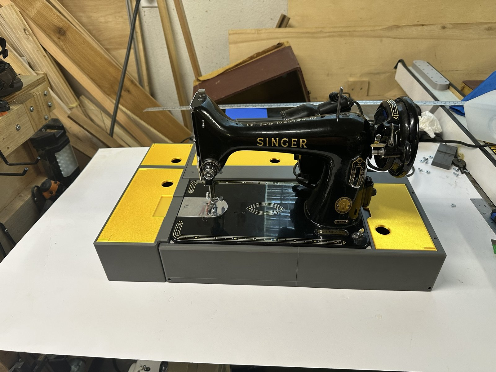
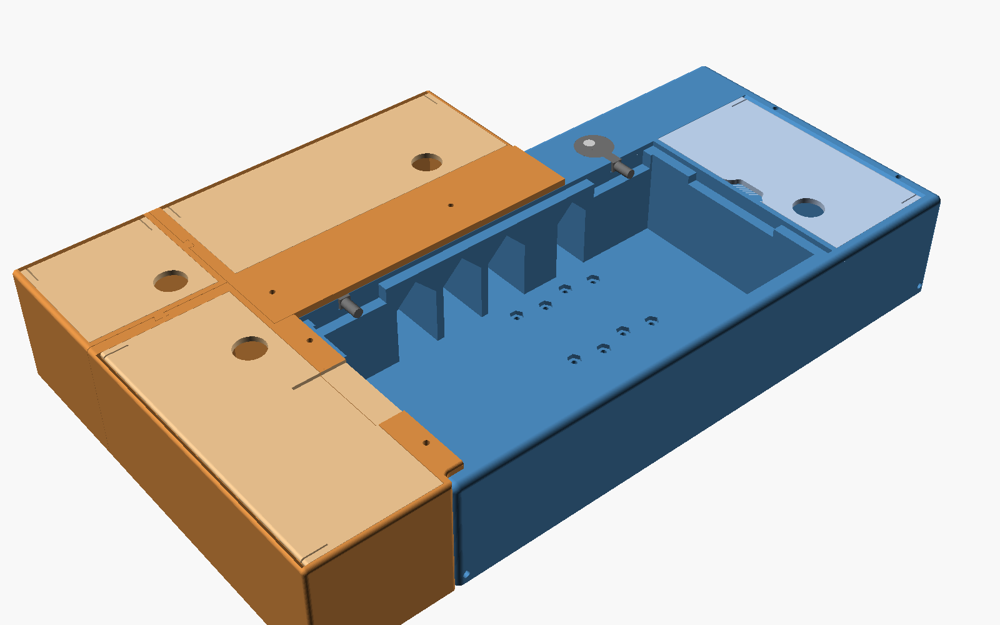

# VSM Base: printable hinged bases for vintage sewing machines

A parametric OpenSCAD model of a portable base for vintage flatbed sewing
machines, with the hinge recesses, bed seat and casting clearances worked
out from measurements of your own machine. It prints on an ordinary
desktop 3D printer, in two halves joined by dovetails and steel mending
plates.

*The first complete build: a Singer 99K in its base, with the back, left
and corner extensions and their lids, in gray and gold PETG.*

> **Research use only: not a safe, buildable design.** The motor-control
> circuits, schematics, enclosures, mechanisms, test procedures and software
> in this project have not been safety-designed, safety-validated,
> certified, or tested as a complete appliance. None of the controller
> designs should be built or connected to the mains as drawn, and none
> should be operated. A concept drawing, simulation, component listing,
> historical example or commercial component is not evidence of compliance
> or safety; printed plastic is not an assessed insulation system or fire
> enclosure, and a barrier drawn on a schematic is not proof of isolation.
> The work is meant to support understanding of how existing and historical
> controls work and what hazards they carry, and to guide the development of
> safer alternatives.
> It is personal learning done in public, not a product, and anyone who
> uses or builds on any of it does so on their own responsibility.
> Any future buildable design would need a new system-
> level engineering assessment, independent review, qualified
> implementation, complete-product testing and applicable certification;
> `docs/VALIDATION.md` lists what that would cover. The base itself, its
> trays and its other printed parts are ordinary printed objects; this
> applies to the motor controls: the knee controller option, the controller
> bay's intended contents, the papers' circuits, and the standalone pedal
> and knee drafts.

`docs/VALIDATION.md` lists what any design would need before it could be called buildable.

## Status: what has been tested

> **Open source, at your own risk.** This is an open-source hobby project,
> not a product. It is published under the MIT license, which provides it
> "as is", without warranty of any kind, and anyone who prints, builds or
> uses anything from it does so at their own risk. It is tested as far as
> one person can test it at a workbench: fit samples, printed parts tried on
> a real machine, and a working base used at home. It has not had the
> structural, endurance, environmental and safety testing a product would
> need (loads, cycles, carrying, heat, aging, misuse), and its motor-control
> designs are research only. A configuration the model can generate is not
> one that has been printed, fitted, load-tested or shown suitable for use.
> Anyone who wants to make a product from this work takes on the whole of
> that validation; `docs/VALIDATION.md` outlines what it would involve.

The words used for status: a *concept* is drawn or modeled only; a part
that has *rendered* has been generated without error; *simulated* means
modeled numerically from assumed values; a *fit sample* is printed and
tried, unpowered; a *build* is a physical object in use; *load-tested*
means tested for strength and endurance, which nothing here has been.

Only a small part of what the model can make has been printed and used,
all of it on a Singer 99K (the default profile), in PETG, from development
versions of the model as it evolved rather than the current one: the base
in its default form (split, dovetails and mending plates, storage
compartment, handholds and harness rods), the back, left and corner
extensions with their hinged lids and printed pegs, the lollipop hinges,
the organizer trays, and test pieces for the outlet block and its cap, the
pass-through's knock-out walls and the split joint's center slice. The
User's Guide (chapter 1, *What has been tested*) gives the details and
the long list of what has not been printed: other machines and custom
profiles, the one-piece base, the printed hinge, the outlet, knee and
controller compartments as wholes, the attached bay, the freestanding
boxes, the motor test rig, and every option set away from its default.
No motor control of any kind has been built.

## Why

A great many vintage sewing machines were sold installed in cabinets and
tables. Few people today have room for a sewing table, and a machine
without a portable base is hard to use, store or even give away, so too
many good machines end up in the landfill.

Collectors make their own bases, and a few small makers sell them. The hard
part has always been the hinge recesses and the fit of the bed, which need
careful machining, so most homemade bases are simply boxes the machine sits
in. Woodworking shops and the skills to use them are becoming rare; 3D
printers are now everywhere and cheap.

This project puts the careful part into the model. You measure the machine's
bed casting, enter the numbers, print a few small test pieces to confirm the
fit on your printer, and then print a base that fits.

## Features

- **Fitted to your casting.** The bed seat, hinge positions, hinge height and
  clearances under thickened parts of the casting are all computed from
  measurements of the bed, not copied from an old base.
- **Lollipop hinge recesses** with the pin axis checked against the bed's
  hinge holes, or a **printed hinge** for machines without usable hinges:
  a printed arm and block with two pieces of steel rod each, a tilt-back
  stop, and the pin set at the bed hole's height automatically. Other hinge
  types can be added.
- **Beds set flush or standing on their feet**, as on 1960s Kenmores, with
  the extensions' lips recessed into the rim and trim strips to fill the
  cuts when the extensions are off, and a slot for cords that leave the
  casting. Profiles for the Singer 99K and the Kenmore 158-14001.
- **Prints in two halves** on a 256 mm printer, joined by dovetail keys and
  three recessed steel mending plates with captive nuts.
- **Optional side compartment**: storage; a mount for the machine's
  light-and-motor outlet with cord slots in its lid; a **knee controller**
  (draft) built around an inexpensive pedal speed-control board, with a
  geared pot, an off switch and hard stops; or a base fitted to the bed
  alone. For beds too long to print with the compartment built in, it can
  be a separate bay screwed to the base's right end, with its own handhold
  and harness rods (storage only, for now).
- **Handholds** under each end, after the original wooden bases, and steel
  rods for a carrying harness.
- **Removable extensions** that sit level with the bed: a back compartment
  and outfeed support, a left compartment and extension table, and a corner
  piece, each with a hinged or lift-out lid (solid or perforated, finger
  hole or thumb tab), and trenches so the bobbin cover can still slide open.
  Each also comes as a freestanding box with the same bay and lid.
- **A ruler on the front face** (optional): inch, centimeter or custom
  scales, one to three stacked, raised, engraved or inlaid in a second
  color, with room for a logo in each upper corner, and more SVG places
  on the back and bottom for a maker's name, model or serial number.
- **Organizer inserts** for the bays: stacking bobbin trays for the corner
  bay (40 class 15/66 bobbins at the defaults), lifted out together by a
  center knob; stacking notion trays for the back or left bay in 10–30 mm
  and custom heights, plain or divided into compartments, and smaller ones
  for the divided outer bays and the corner's square bays; and a spool tray
  that holds each spool with its bobbin on top. Others can be designed
  against a published list of bay sizes; see [docs/inserts.md](docs/inserts.md).
- **A nut tool**: a printed rod for holding a nut in a trap while the
  screw is started, for common inch and metric nuts; see
  [standalone/nut-tool/](standalone/nut-tool/).
- **A motor test rig** for the knee controller work: a plywood board of
  printed modules for measuring a sewing motor (resistance, inductance,
  speed, torque with a Prony brake) and the triac board; see
  [standalone/motor-rig/](standalone/motor-rig/RIG_GUIDE.md).
- **A standalone bobbin box**: the corner bay and its five bobbin trays as a
  small lidded box in one self-contained file, for anyone who wants the box
  without the base; see [standalone/bobbin-box/](standalone/bobbin-box/).
- **A tilt prop**: a stand that holds the machine tipped back for
  servicing, with a cradle or a flat top, level or sloped, on a foot sized
  to stay upright; see [standalone/tilt-prop/](standalone/tilt-prop/).
- **A harness handle (experimental)**: a grip for a carrying harness of
  two lengths of webbing crossed over the machine, which run through a
  tunnel in it. Not yet printed, and not for carrying a machine until a
  complete harness has passed a proof-load test. See
  [standalone/harness-handle/](standalone/harness-handle/).
- **Three measuring tools** for fitting parts inside a machine: a slide
  gauge for the height from a casting floor to the underside of a shaft, a
  sliding gauge for the clear floor between two ribs, and a set of snap-on
  test collars for finding the bore a printed part needs on a shaft of
  unknown size; see
  [standalone/shaft-height-gauge/](standalone/shaft-height-gauge/),
  [standalone/floor-span-gauge/](standalone/floor-span-gauge/) and
  [standalone/shaft-fit-collars/](standalone/shaft-fit-collars/).
- **A force-sensing foot pedal (draft)**: a heel-hinged, low-voltage pedal
  enclosing an Interlink FSR 406 and a small board, for the analog
  controller in the design study *An Analog Force-Sensing Knee
  Controller*; not yet printed. See
  [standalone/fsr-pedal/](standalone/fsr-pedal/).
- **A force-sensing knee housing (draft)**: the knee controller's spring
  housing with a sensor tower beside the return spring, holding an
  Interlink FSR 402 under a progressive two-spring stack, for the same
  analog controller; not yet printed. See
  [standalone/fsr-knee/](standalone/fsr-knee/).
- **Test parts** for checking the fit, the joints and the hardware before
  committing to a long print.
- **Self-checking.** Every render prints the key dimensions and warns about
  problems such as a hinge pin that won't meet the bed's holes or a part too
  big for your printer.

## Status

Developed and test-printed for a **Singer 99K**, whose measurements are the
defaults. A full base with its extensions and inserts has been built; see
*Status: what has been tested* above for exactly what. Profiles for other machines (Singer 128, Kenmore flatbeds
and others) are welcome; see the guide.

## Quick start

1. Install [OpenSCAD](https://openscad.org) (2021.01 or later) and the
   [BOSL2](https://github.com/BelfrySCAD/BOSL2) library.
2. Open `scad/vsm_base.scad` and show the Customizer
   (*Window → Customizer*).
3. **Measure your machine's bed casting** and enter the numbers in
   *Machine bed*. The User's Guide ([measuring chapter](docs/guide/03-measuring.md)) explains each
   measurement. Don't skip this, even for a 99: castings vary.
4. Read the console output after each render (F5/F6), and fix any WARNING
   lines before going further.
5. Set `part = "test_parts"`, render, export the STL, print it, and check
   each piece against your machine and your hardware.
6. Set `printer_size` and `printer_margin` for your printer, then
   `part = "all"`: every part of the build, laid out flat in print
   orientation and grouped into plates. The console lists the plates; set
   `print_plate` to export them one at a time. `part = "exploded"` shows
   how everything goes together.

## What you need

- A printer with at least about 230 × 230 × 90 mm of build volume (the
  split 99 base halves are about 224 × 219 × 83 mm).
- PETG: roughly 2 kg for a base with a side compartment, and a few hundred
  grams for each extension. The base is about 3.4 litres of solid
  material, so the real figure depends on your walls and infill; your
  slicer will tell you.
- Hardware for the base:
  - 2 lollipop hinges (or vintage barrel hinges from a portable case, with
    `hinge_type = "barrel"`; or, with `hinge_type = "printed"`, steel rod for the
    printed hinges: 2 pins (9/32" for a 99) and 2 pivots (1/4"), lengths in the
    console's hardware list)
  - 3 flat steel mending plates, 4" × 5/8", countersunk for #8
    (McMaster-Carr 1394A34 or similar)
  - 12 #8-32 × 1/2" flat-head machine screws and 12 #8-32 nylon-insert
    locknuts (plain hex nuts fit the traps too)
    (mending plates)
  - 2 #8-32 machine screws, about 1" long, and 2 nylon-insert locknuts
    (hinges)
  - 4 3/16" × 2⅝" dowel pins (carrying harness; optional), or 3/16" rod
    cut to length (mild steel, 303 stainless, or lead-free brass such as
    464); the hole ends are closed with printed plugs. The console gives
    the length for your build
  - Bed cushions, 1/16" thick when compressed

The console ends with a hardware list for your configuration, with screw
lengths rounded up to stock sizes.

## Documentation

- **User's Guide**: measuring, configuring, testing, printing and
  assembly. Each [release](https://github.com/bobdrzyzgula/VSM-Base/releases)
  carries it as a PDF and as a single HTML page that opens in any browser.
- Between releases, read the guide here: its source is in
  [`docs/guide/`](docs/guide/), one Markdown file per chapter, and reads
  directly on GitHub. Or build the PDF and HTML yourself (below).
- [`docs/guide/90-parameters.md`](docs/guide/90-parameters.md) lists every
  parameter. It is generated from the comments in the model.
- **Speed Control of Universal Motors in Sewing Machines**: a paper on how
  sewing-machine motors respond to each kind of speed control, from rheostats
  and carbon piles to triac and feedback controllers, and on the two
  controller designs for the base. Its source is in
  [`docs/motor-control/`](docs/motor-control/); releases carry it as PDF and
  HTML.
- **Inside the Motor**: the companion paper on how the motors themselves
  are built. It covers the universal motor in iron and copper, its
  waveforms on the line, behind a rheostat and behind a triac, and its
  relatives: wound-field and permanent-magnet DC motors, brushless motors
  and induction motors. It closes on whether a small DC motor could drive
  a vintage machine. Its source is in
  [`docs/motor-construction/`](docs/motor-construction/); releases carry it
  as PDF and HTML.
- **Inside a Switching Circuit**: the second companion paper, on the
  switches inside the controls. It covers the thyristor and the triac, a
  phase-control pedal circuit part by part, the snubber, the knee
  controller's donor board worked through in detail, and the MOSFETs and
  IGBTs behind PWM and variable-frequency drives. Its source is in
  [`docs/switching/`](docs/switching/); releases carry it as PDF and HTML.
- **A Force-Sensing Pedal**: a design study for a foot pedal that senses
  force with a force-sensing resistor and drives a triac with no supply or
  microcontroller, as a two-terminal device that fits a standard cordset.
  It covers the circuit, a simulation of its force-to-speed curve, the
  stress on the sensor, the pedal around it, and a test plan. Not yet
  built. Its source is in [`docs/fsr-pedal/`](docs/fsr-pedal/); releases
  carry it as PDF and HTML.
- **An Analog Force-Sensing Knee Controller**: a design study for a knee
  controller with no microcontroller, isolated from the mains, in which an
  FSR sets the speed through a zero-cross-synchronized ramp and a
  comparator. It shares the MCU controller's mains side, and covers the
  circuit, its simulated response and tolerances, and how a force sensor
  can serve a knee lever. Not yet built. Its source is in
  [`docs/analog-knee/`](docs/analog-knee/); releases carry it as PDF and
  HTML.
- **The motor test rig's guide**: building and using the bench rig in
  [`standalone/motor-rig/`](standalone/motor-rig/); releases carry it as a
  PDF.

To build the documentation, see the [`Makefile`](Makefile): `make params`,
`make images`, `make pdf`, `make html`, or `make docs` for both. They build
the guide, the three papers and the rig guide into `build/`.

A snapshot of the documents as HTML pages, committed by hand and not always
the latest, is published at
[vsm-base.ephemeral-bozonics.com](https://vsm-base.ephemeral-bozonics.com/)
(from [`docs-snapshot/`](docs-snapshot/)), for reading online or sending as
a link.

- **`make pdf` and `make html`** need pandoc 3.1.2 or later. The PDF also
  needs [Typst](https://typst.app), 0.12 or later with a recent pandoc (the
  release build uses pandoc 3.7.0.2 and Typst 0.13.1). `make pdf
  TYPST=/path/to/typst` uses a Typst binary that isn't on your path.
- **`make images`** regenerates the figures, and needs more:
  - [OpenSCAD](https://openscad.org) with BOSL2, for the model's renders
    (on a machine with no display, run it under `xvfb-run`);
  - [KiCad](https://www.kicad.org) 7 or later, for `kicad-cli`, which
    exports the schematics;
  - Python 3 with matplotlib, NumPy and Pillow, for the charts, waveforms
    and drawings.

  The figures are committed to the repository, so building the documents
  doesn't need `make images` unless a figure has changed.

To check the model after a significant change, `make matrix` runs it over
every combination of machine, compartment, mount, hinge, split and
extensions (a few minutes), and `make matrix-full` also renders the
printable parts (about a quarter of an hour on two cores). Both compare the
failed asserts, warnings, broken renders and solid counts with a committed
baseline, report in `build/test-matrix.md`, and fail if anything changed;
see [`tools/test_matrix.py`](tools/test_matrix.py). Passing means only that
the model generates what it did before, not that anything prints, fits or
holds. The moving parts (hinges, lids, the knee mechanism) are not swept
through their travel for collisions; that is left as an exercise.
Both first run `make lazy-check`
([`tools/check_lazy_union.py`](tools/check_lazy_union.py)), which reads the
.scad files for code whose meaning changes when OpenSCAD's experimental
lazy union is on (as it is for multi-color 3MF export): a `for`, an
`if` with more than one object, or `children()`, inside `intersection()` or
first in `difference()`. Lazy union passes such a child's objects on one by
one, so they are intersected with or subtracted from one another; wrapping
the child in `union()` cures it.

A version tag (`v*`) builds the documents and attaches them to a GitHub
release (see
[`.github/workflows/release.yml`](.github/workflows/release.yml)).

## Credits

Designed and tested by Robert Drzyzgula. The OpenSCAD code, the User's
Guide, the motor-control paper and *Inside the Motor* were written by Claude
(Anthropic) at his direction, with Claude contributing engineering background and research
along the way.

## License

MIT; see [LICENSE](LICENSE). Copyright © 2026 Robert Drzyzgula. The
license provides the work "as is", without warranty of any kind; see
*Status* above.
