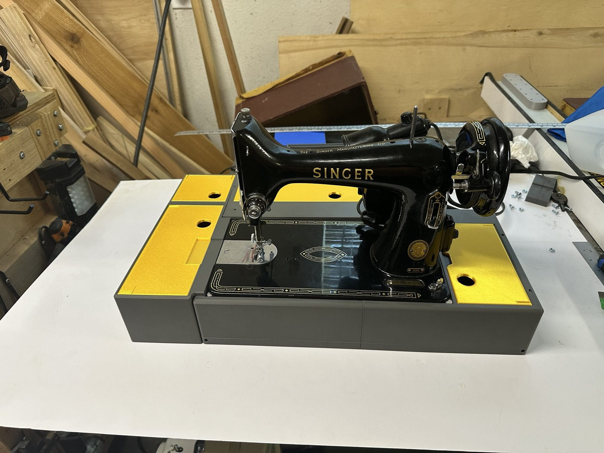
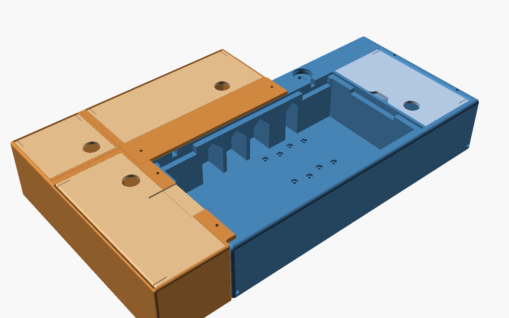

# VSM Base: printable hinged bases for vintage sewing machines

A parametric OpenSCAD model of a portable base for vintage flatbed sewing
machines, with the hinge recesses, bed seat and casting clearances worked
out from measurements of your own machine. It prints on an ordinary
desktop 3D printer, in two halves joined by dovetails and steel mending
plates.

*The first complete build: a Singer 99K in its base, with the back, left
and corner extensions and their lids, in gray and gold PETG.*

## Status: what has been tested

Only a small part of what the model can make has been printed and used.
Treat everything else as **untested on a real printer**: it has been checked
in the model, but not built.

Tested, on a Singer 99K (the default machine profile), printed in PETG:

- the base in its default form: split into two halves with the dovetail
  keys and mending plates, the storage compartment, the handholds and
  harness rods;
- the back, left and corner extensions with their hinged lids, the printed
  extension pegs (tapped into the lips with a hammer; they then mate with
  the base's holes), and the extended back lip;
- the lollipop hinges, mounted with 1" #8-32 screws and nylon-insert
  locknuts in the nut traps; the mending plates, held by
  1/2" #8-32 flat-head screws into nylon-insert locknuts in their traps
  (the screws push through the printed membranes);
- the organizer insert test parts (`bobbin_test`, `notion_test`) and the
  full stack of five bobbin trays; a spool tray and a divided notion tray
  for the back bay. On the spool tray, in silk PLA, a curb split from the
  floor at the first layer above it; the gussets and taller curb added
  since have not been printed yet.

These were printed from development versions of the model as it evolved,
not from the current one: later changes (the split joint's serrations, for
one) have not all been printed yet.

Not yet tested, among others: other machines and custom profiles; the base
printed in one piece; the outlet, knee-controller and jack compartments;
the freestanding boxes, the standalone bobbin box, the motor test rig and the attached bay; a base without hinges; the printed hinge; flush beds, beds on their feet, recessed lips, trims and the cord slot; the Kenmore 158-14001 profile; the turn button; pin or molded extension pegs; the
pass-through cover; and every option set away from its default. The knee
controller and the motor-control paper's designs have not been built at
all.

## Why

A great many vintage sewing machines were sold installed in cabinets and
tables. Few people today have room for a sewing table, and a machine
without a portable base is hard to use, store or even give away, so too
many good machines end up in the landfill.

Collectors make their own bases, and a few small makers sell them. The hard
part has always been the hinge recesses and the fit of the bed, which need
careful machining, so most homemade bases are simply boxes the machine sits
in. Woodworking shops and the skills to use them are becoming rare; 3D
printers are now everywhere and cheap.

This project puts the careful part into the model. You measure the machine's
bed casting, enter the numbers, print a few small test pieces to confirm the
fit on your printer, and then print a base that fits.

## Features

- **Fitted to your casting.** The bed seat, hinge positions, hinge height and
  clearances under thickened parts of the casting are all computed from
  measurements of the bed, not copied from an old base.
- **Lollipop hinge recesses** with the pin axis checked against the bed's
  hinge holes, or a **printed hinge** for machines without usable hinges:
  a printed arm and block with two pieces of steel rod each, a tilt-back
  stop, and the pin set at the bed hole's height automatically. Other hinge
  types can be added.
- **Beds set flush or standing on their feet**, as on 1960s Kenmores, with
  the extensions' lips recessed into the rim and trim strips to fill the
  cuts when the extensions are off, and a slot for cords that leave the
  casting. Profiles for the Singer 99K and the Kenmore 158-14001.
- **Prints in two halves** on a 256 mm printer, joined by dovetail keys and
  three recessed steel mending plates with captive nuts.
- **Optional side compartment**: storage; a mount for the machine's
  light-and-motor outlet with cord slots in its lid; a **knee controller**
  (draft) built around an inexpensive pedal speed-control board, with a
  geared pot, an off switch and hard stops; or a base fitted to the bed
  alone. For beds too long to print with the compartment built in, it can
  be a separate bay screwed to the base's right end, with its own handhold
  and harness rods (storage only, for now).
- **Handholds** under each end, after the original wooden bases, and steel
  rods for a carrying harness.
- **Removable extensions** that sit level with the bed: a back compartment
  and outfeed support, a left compartment and extension table, and a corner
  piece, each with a hinged or lift-out lid (solid or perforated, finger
  hole or thumb tab), and trenches so the bobbin cover can still slide open.
  Each also comes as a freestanding box with the same bay and lid.
- **Organizer inserts** for the bays: stacking bobbin trays for the corner
  bay (40 class 15/66 bobbins at the defaults), lifted out together by a
  center knob; stacking notion trays for the back or left bay in 10–30 mm
  and custom heights, plain or divided into compartments; and a spool tray
  that holds each spool with its bobbin on top. Others can be designed
  against a published list of bay sizes; see [docs/inserts.md](docs/inserts.md).
- **A nut tool**: a printed rod for holding a nut in a trap while the
  screw is started, for common inch and metric nuts; see
  [standalone/nut-tool/](standalone/nut-tool/).
- **A motor test rig** for the knee controller work: a plywood board of
  printed modules for measuring a sewing motor (resistance, inductance,
  speed, torque with a Prony brake) and the triac board; see
  [hardware/motor-rig/](hardware/motor-rig/RIG_GUIDE.md).
- **A standalone bobbin box**: the corner bay and its five bobbin trays as a
  small lidded box in one self-contained file, for anyone who wants the box
  without the base; see [standalone/bobbin-box/](standalone/bobbin-box/).
- **A tilt prop**: a stand that holds the machine tipped back for
  servicing, with a cradle or a flat top, level or sloped, on a foot sized
  to stay upright; see [standalone/tilt-prop/](standalone/tilt-prop/).
- **Test parts** for checking the fit, the joints and the hardware before
  committing to a long print.
- **Self-checking.** Every render prints the key dimensions and warns about
  problems such as a hinge pin that won't meet the bed's holes or a part too
  big for your printer.

## Status

Developed and test-printed for a **Singer 99K**, whose measurements are the
defaults. A full base with its extensions and inserts has been built; see
*Status: what has been tested* above for exactly what. Profiles for other machines (Singer 128, Kenmore flatbeds
and others) are welcome; see the guide.

## Quick start

1. Install [OpenSCAD](https://openscad.org) (2021.01 or later) and the
   [BOSL2](https://github.com/BelfrySCAD/BOSL2) library.
2. Open `scad/vsm_base.scad` and show the Customizer
   (*Window → Customizer*).
3. **Measure your machine's bed casting** and enter the numbers in
   *Machine bed*. The User's Guide ([measuring chapter](docs/guide/03-measuring.md)) explains each
   measurement. Don't skip this, even for a 99: castings vary.
4. Read the console output after each render (F5/F6), and fix any WARNING
   lines before going further.
5. Set `part = "test_parts"`, render, export the STL, print it, and check
   each piece against your machine and your hardware.
6. Set `printer_size` and `printer_margin` for your printer, then
   `part = "all"`: every part of the build, laid out flat in print
   orientation and grouped into plates. The console lists the plates; set
   `print_plate` to export them one at a time. `part = "exploded"` shows
   how everything goes together.

## What you need

- A printer with at least about 230 × 230 × 90 mm of build volume (the
  split 99 base halves are about 224 × 219 × 83 mm).
- PETG: roughly 2 kg for a base with a side compartment, and a few hundred
  grams for each extension. The base is about 3.4 litres of solid
  material, so the real figure depends on your walls and infill; your
  slicer will tell you.
- Hardware for the base:
  - 2 lollipop hinges (or, with `hinge_type = "printed"`, steel rod for the
    printed hinges: 2 pins (9/32" for a 99) and 2 pivots (1/4"), lengths in the
    console's hardware list)
  - 3 flat steel mending plates, 4" × 5/8", countersunk for #8
    (McMaster-Carr 1394A34 or similar)
  - 12 #8-32 × 1/2" flat-head machine screws and 12 #8-32 nylon-insert
    locknuts (plain hex nuts fit the traps too)
    (mending plates)
  - 2 #8-32 machine screws, about 1" long, and 2 nylon-insert locknuts
    (hinges)
  - 4 3/16" × 2⅝" dowel pins (carrying harness; optional), or 3/16" rod
    cut to length (mild steel, 303 stainless, or lead-free brass such as
    464); the hole ends are closed with printed plugs. The console gives
    the length for your build
  - Bed cushions, 1/16" thick when compressed

The console ends with a hardware list for your configuration, with screw
lengths rounded up to stock sizes.

## Documentation

- **User's Guide**: measuring, configuring, testing, printing and
  assembly. Each [release](https://github.com/bobdrzyzgula/VSM-Base/releases)
  carries it as a PDF and as a single HTML page that opens in any browser.
- Between releases, read the guide here: its source is in
  [`docs/guide/`](docs/guide/), one Markdown file per chapter, and reads
  directly on GitHub. Or build the PDF and HTML yourself (below).
- [`docs/guide/90-parameters.md`](docs/guide/90-parameters.md) lists every
  parameter. It is generated from the comments in the model.
- **Speed Control of Universal Motors in Sewing Machines**: a paper on how
  sewing-machine motors respond to each kind of speed control, from rheostats
  and carbon piles to triac and feedback controllers, and on the two
  controller designs for the base. Its source is in
  [`docs/motor-control/`](docs/motor-control/); releases carry it as PDF and
  HTML.

To build the documentation, see the [`Makefile`](Makefile): `make params`,
`make images`, `make pdf`, `make html`, or `make docs` for both. They build
the guide and the motor-control paper into `build/`. Both need pandoc 3.1.2 or later; the PDF also needs
[Typst](https://typst.app), 0.12 or later with a recent pandoc (the release
build uses pandoc 3.7.0.2 and Typst 0.13.1). `make pdf TYPST=/path/to/typst`
uses a Typst binary that isn't on your path. A version tag (`v*`) builds both and attaches them
to a GitHub release (see
[`.github/workflows/release.yml`](.github/workflows/release.yml)).

## Credits

Designed and tested by Robert Drzyzgula. The OpenSCAD code, the User's
Guide and the motor-control paper were written by Claude (Anthropic) at his
direction, with Claude contributing engineering background and research
along the way.

## License

MIT; see [LICENSE](LICENSE). Copyright © 2026 Robert Drzyzgula.
