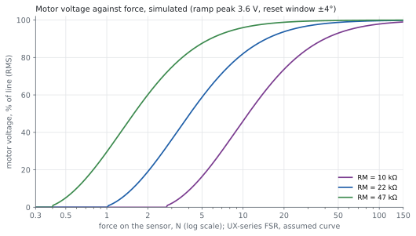

# The circuit simulated

## The model

The figures come from `tools/make_analog_knee_figures.py`. Unlike the
pedal's RC network, this circuit has no state carried between
half-cycles, so its behavior can be computed directly:

- **The ramp** starts from zero at the end of the reset window, ±4° around
  each zero crossing, and rises in a straight line to about 3.59 V just
  before the next window (45.1 µA into 0.1 µF over 7.96 ms).
- **The firing angle** is where the ramp reaches the command D:
  $\alpha = 4° + 172° \times V_D / 3.59\ \text{V}$. If D is above the
  ramp's peak, nothing fires.
- **The command** is $V_D = 5\ \text{V} \times R / (R + R_M)$, with the
  FSR's resistance $R$.
- **The FSR** follows the same assumed power law as the pedal paper:
  $R = 100\ \text{k}\Omega \times (F / 0.5\ \text{N})^{-0.8}$, for the UX
  series, to be replaced by measurements.
- **Motor voltage** is the RMS voltage a resistive load would see, as a
  percentage of the line.

## One operating point

{width=100%}

## Force against speed

{width=100%}

With RM = 22 kΩ:

| Force on the sensor | Motor voltage |
|---|---|
| 1.0 N | Starts, from zero |
| 2.3 N | 25% |
| 4.1 N | 50% |
| 7.9 N | 75% |
| 15 N | 90% |
| 50 N | About 99% |

RM sets where the range falls: 10 kΩ moves the start to 2.8 N and 90% to
40 N; 47 kΩ moves them to 0.4 N and 5.8 N. The motor can reach nearly full
voltage, because the earliest firing is just after the reset window ends.
The curve is roughly logarithmic in force through its middle, as in the
pedal, from the same cause: the FSR's power law.

**Line voltage doesn't matter.** The firing angle depends only on D and
the ramp. A low line gives the motor less voltage at a given angle, as
any phase control does, but doesn't move the angle.

## What moves the curve

{width=100%}

| Variation | Starts at | 90% at |
|---|---|---|
| Nominal | 1.0 N | 15 N |
| Ramp 10% slower | 1.5 N | 17.5 N |
| Ramp 10% faster | 0.6 N | 12.8 N |
| FSR 25% higher resistance | 1.4 N | 19.8 N |
| FSR 20% lower resistance | 0.8 N | 11.3 N |
| Reset window ±8° | 1.3 N | 16.9 N |

- **The ramp** depends on RSET, CR and the LM334's temperature: its
  current rises about a third of a percent per degree Celsius, so a 10 °C
  change moves the ramp about 3%. A 1% resistor and a 5% film capacitor
  keep the rest small.
- **The FSR's part-to-part spread** is the largest single variation.
  Swapping a sensor moves the curve by about as much as the figure shows,
  and RM can be trimmed to put it back.
- **The reset window** barely matters.

None of these approaches the factor of two the diac's tolerance causes in
the pedal circuit (pedal paper, §4.4). RM as a trimmer, or a fixed RM
chosen after measuring the sensor, covers all of them.
