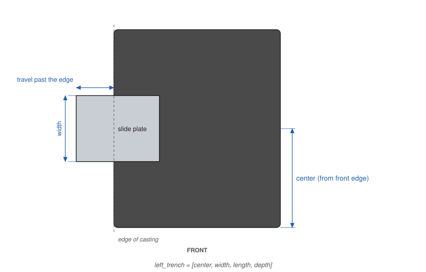

# Measuring your machine

This is the most important chapter in the guide. Every critical dimension
of the base is computed from a handful of measurements of your machine's
bed casting. If they are right, the base fits; if one is wrong, the base
will be wrong in a way no amount of printer tuning can fix.

## Measure the casting, not an old base

If your machine came in an old wooden base, it is tempting to copy that.
Don't. Wooden bases were hand-fitted, they shrink and wear over decades,
and many have been swapped between machines: a base that came with your
99 may have been made for a 128, or fitted by eye in a shop sixty years
ago. The cast-iron bed of the machine has not changed since it left the
factory. Measure that.

## Tools

- **Calipers** (dial or digital), 6" or larger. These are essential for
  everything under an inch: plate thickness, hole position, hole diameter
  and the thickness of the casting's bosses.
- **A steel rule**, 12" or longer, graduated in 32nds or 64ths, for the
  bed's length and width.
- **A small square** is useful for measuring the hinge-hole height.
- Paper and pencil. Write every number down as you measure it; the
  [worksheet](#measurement-worksheet) at the end of this chapter has a
  place for each one.

Measure everything at least twice. Where the guide asks for the same
measurement at both ends of the bed, take both and compare them.

## Getting ready

Remove the machine from any base or cabinet, take off the motor belt guard
or anything else that hangs below the bed if it's easy to remove, and
work on a clean, flat table. Several measurements are easiest with the
machine on its back (hinge side down) or upside down on a towel.

Fractions to decimals, for entering the bed measurements:

| 16ths | inch | 16ths | inch | 16ths | inch | 16ths | inch |
|---|---|---|---|---|---|---|---|
| 1/16 | 0.0625 | 5/16 | 0.3125 | 9/16 | 0.5625 | 13/16 | 0.8125 |
| 1/8 | 0.125 | 3/8 | 0.375 | 5/8 | 0.625 | 7/8 | 0.875 |
| 3/16 | 0.1875 | 7/16 | 0.4375 | 11/16 | 0.6875 | 15/16 | 0.9375 |
| 1/4 | 0.25 | 1/2 | 0.5 | 3/4 | 0.75 | 1 | 1.0 |

## The bed outline

{width=100%}

### Bed length, `bed_length_in`

Measure the bed from end to end, left to right, along its top surface.
Measure along a straight part of the edge, not across the rounded corners,
and read the rule at the very ends of the casting, not at any paint lip
or decal.

The base's seat is made `bed_clearance` (0.75 mm) larger than the bed on
each side, so the bed drops in without binding. Don't add your own
allowance: enter what you measure.

### Bed width, `bed_width_in`

Measure the bed from front to back in the same way, near the middle of the
bed where the front and back edges are straight.

### Plate thickness, `bed_plate_thickness_in`

The bed is a flat plate with a skirt and bosses cast underneath. Measure
the thickness of the flat plate with calipers at a front edge or an end,
away from any thickened area. On the Singer 99 it is 5/16".

The plate thickness, together with the hinge-hole height below, determines
how deep the hinge pins must sit in the base, so it has to be right.

## The hinge holes

*If your machine has no hinges, or you'd rather build a plain base for it
to sit in, set `hinge_type = "none"` and skip this section; see the note on
bases without hinges in Configuring the model.*

The machine pivots on two pins that enter holes in the rear skirt of the
bed. The model places the hinge recesses so that the pins line up with
those holes exactly, both along the back and in height.

{width=60%}

### Hole position, `hinge_hole_inset_in`

Measure from each end of the bed to the **center** of the nearer hinge
hole. The center can't be measured directly, so measure from the end of
the bed to the near edge of the hole and to the far edge, and average the
two; or measure to the near edge and add half the hole's diameter.

Do this at both ends. The model assumes the holes are the same distance
from each end. On the 99 they are 1 7/16" from each end.

**Check your work.** Also measure the distance between the two hole
centers. The two insets plus the spacing between the holes must add up to
the bed length:

> inset + spacing + inset = length
>
> On the 99: 1 7/16" + 9 5/16" + 1 7/16" = 12 3/16". ✓

If they don't add up, measure again before going any further. If the two
insets really differ by more than about 1/32", the model's symmetric
placement won't fit your machine; see the chapter on other machines.

### Hole height, `hinge_hole_drop_in`

Measure how far the **center** of the hinge hole is below the **top
surface** of the bed. With the machine on its back, lay a small square or
a straightedge across the bed's top surface where it overhangs the hole,
and measure from it to the top and bottom edges of the hole; the center is
halfway between. On the 99 it is 3/8".

{width=100%}

### Hole diameter

Measure the hinge holes' diameter. For lollipop hinges it isn't a model
parameter, but it is the diameter of the hinge pins you need. For the
printed hinge it sets the steel pin's diameter (`custom_hinge_pin_d_mm`):
choose rod just under the hole's size, so the pin slides in without play.
On the 99 the holes are 1/4"; on the Kenmore 158, 6 mm. Measure how deep
the holes go too, if you can, or how far the old hinge's pins went in: the
printed hinge's pin enters them by `custom_hinge_pin_engage_mm` (12 mm on
the 99K, 16 mm on the Kenmore), which must not be more than their depth.

### Bed cushions, `bed_cushion_in`

Most bases have small rubber or felt cushions under the corners of the
bed, which quiet the machine and keep it from rocking. The model lifts the
bed by their thickness when it works out the hinge height. Enter the
thickness of your cushions *when compressed* under the machine's weight;
the default is 1/16". If you use no cushions, enter 0.

Fit the cushions before you check anything against the machine: without
them the bed sits lower than the model expects, and the extensions will
stand proud of it. Cushions also vary in how much they compress. Once the
base is printed and the machine sits in it on its cushions, lay a
straightedge from the bed onto an extension (or its top slice from the
test parts). If the extension is high or low, set `ext_top_adjust` to the
difference (negative lowers it); it moves the whole extension top plane,
lids, lips and bobbin trenches together.

Once these numbers are entered, the console reports the height of the
bed's hole axis and the height of the hinge pins' axis. They must agree:
if they differ by more than a quarter of a millimetre the model prints a
WARNING. Fix that before printing anything.

## Thickened areas of the casting, `bed_reliefs`

Around its edge, the bed rests on a ledge in the base. Most castings are
thickened in places along the edge: bosses around the hinge holes, ribs at
the ends, lugs for screws. Wherever the casting hangs below the flat plate
over the ledge, the ledge must be cut away under it, or the bed won't sit
down. These cut-aways are the **reliefs**.

{width=60%}

{width=100%}

Turn the machine upside down and look along each edge. For each place
where the casting is deeper than the flat plate within about 10 mm (3/8")
of the edge, measure:

- **Which edge** it is on: `"left"`, `"right"`, `"back"` or `"front"`.
- **Where it starts and where it ends** along that edge. Measure along the
  back and front edges from the bed's *left end*, and along the left and
  right ends from the bed's *front edge*. The **center** is halfway between
  the start and the end, and the **length** is the end minus the start.
- **How thick** the casting is there, measured from the bed's top surface
  down to the lowest point of the boss. At the edge of the bed you can
  usually reach both surfaces with the outside jaws of the calipers.

{width=60%}

`bed_reliefs` is in **millimetres** (inches × 25.4). Each entry is
`[edge, center, length, thickness]`, and the whole setting is a list of
entries:

```
bed_reliefs = [["left",  83.34, 76.2, 15], ["right", 83.34, 76.2, 15],
               ["back",  36.51, 50.8, 20], ["back", 273.05, 50.8, 20]];
```

The model makes each relief a little bigger than you measured: 2 mm longer
at each end (`relief_margin`) and 1 mm deeper (`relief_clearance`). You
don't need to add your own allowance, but when an edge is hard to see, it
is better to measure generously than tightly. A relief that is too big is
invisible once the machine is in the base; one that is too small stops the
bed from seating.

The console lists each relief with its position and depth, so you can
check that it landed where you meant.

## Room under the bed

The base's cavity has to clear everything that hangs below the bed: the
hook or shuttle drive, the feed mechanism, the shafts and their bearings.
With the defaults, the cavity is about 295 × 152 mm in plan, set 8 mm in
from the bed's edge all round (`bed_ledge`), and there are about 75 mm
(just under 3") from the bed's top surface to the cavity floor.

With the machine upside down, lay a straightedge across the bottom of the
bed and measure how far the lowest part of the mechanism stands above it;
add the plate thickness to get its depth below the bed's top surface.
Check, too, that nothing hangs below the bed within 8 mm of its edge
except the bosses you entered as reliefs. If anything is too deep, increase
`inner_depth`; if anything is too close to the edge, reduce `bed_ledge` or
add a relief.

The center slice in the test parts (see the chapter on test parts) has the
full inside profile of the base, and is the best check: slide it along the
underside of the machine and see that nothing touches.

A machine that stands on cast feet under the casting can be carried on
them instead (see *a bed set flush, or standing on its feet* in
Configuring the model): stand it on a flat surface and measure from the
surface to the plate's underside, for `custom_foot_height_mm`. To find
where the feet are, print the foot-locating rig (`foot_rig_left` and
`foot_rig_right`, bolted together with eight M3 bolts through the splice
tabs): a thin box 80 mm tall that fits round the bed, with a narrow floor
rim, an open bottom, and a floor bar across each half to keep it square,
`rig_bar_in` (100 mm) in from each end of the bed; set that where no foot
can land. Each half also prints with a thin tie across its open end,
to hold its walls against warping on the printer; snap it off at its necks
before bolting the halves together. Print with a brim, or your slicer's
mouse-ear brim at the corners; `rig_ears` adds ears to the part itself for
a slicer that has none. Screw it to a board over a sheet of paper, mark the
paper through the six small holes in the floor rim (each 5 mm in from the
bed's edges, at the corners and at the split; the console lists their
exact positions), ink the feet, and lower the machine into the box. Measure
each foot's print from the marks. The rig is cut for the machine profile in
use, with a notch for its cords if it has a cord slot. Everything
else under the bed must then be shorter than the feet; the Kenmore 158's
feet are 63 mm. Note, too, anything that leaves the casting through its
edge, such as a cord, for `custom_cord_slot`.

## The bobbin cover, `left_trench` and `back_trench`

On drop-in bobbin machines the bobbin is reached through a slide plate in
the bed, which slides out past the edge of the casting. The base itself
doesn't get in its way, because the bed stands above the base's top
surface. The extensions, though, are level with the bed, so an extension
on that side needs a shallow trench for the plate to slide into.

{width=60%}

{width=60%}

{width=90%}

Measure, in millimetres:

- **Center**: the middle of the plate across its width, from the bed's
  front edge (for `left_trench`) or from the bed's left end (for
  `back_trench`).
- **Width**: the plate's width plus about 1 mm of clearance each side.
- **Length**: how far past the edge of the casting the plate must slide to
  uncover the bobbin, plus a margin. Allow at least 1/4" more than you
  measure.
- **Depth**: the plate's thickness plus about 0.5 mm.

On the Singer 99 the plate is 2 3/16" wide, centered on the left end, 2 mm
thick, and slides about 1 1/4" past the casting, giving
`left_trench = [83.34, 57.6, 40, 2.5]`. On the Singer 128 the plate slides
toward the back, and `back_trench` is used instead. Set a trench to `[]`
if your machine doesn't need one.

## Worked example: Singer 99K

These are the defaults in the model, measured from a 1950s Singer 99K.
Your 99 should be very close, but measure it anyway.

| Measurement | Measured | Parameter | Entered |
|---|---|---|---|
| Bed length | 12 3/16" | `bed_length_in` | `12.1875` |
| Bed width | 6 9/16" | `bed_width_in` | `6.5625` |
| Plate thickness | 5/16" | `bed_plate_thickness_in` | `0.3125` |
| Hinge hole from each end | 1 7/16" | `hinge_hole_inset_in` | `1.4375` |
| Hinge hole below bed top | 3/8" | `hinge_hole_drop_in` | `0.375` |
| Bed cushions, compressed | 1/16" | `bed_cushion_in` | `0.0625` |
| Hinge hole diameter | 1/4" | (hinge pins) | — |
| End bosses, middle 3" of each end | 15 mm thick | `bed_reliefs` | `["left", 83.34, 76.2, 15]`, `["right", 83.34, 76.2, 15]` |
| Hinge bosses, 1" either side of each hole | 20 mm thick | `bed_reliefs` | `["back", 36.51, 50.8, 20]`, `["back", 273.05, 50.8, 20]` |
| Slide plate | 2 3/16" wide, 2 mm thick, 1 1/4" travel | `left_trench` | `[83.34, 57.6, 40, 2.5]` |

Every measurement on this machine is an odd number of sixteenths of an
inch, and the hinge-hole check adds up exactly: a good sign that the
numbers are right.

## Checking your numbers

After entering your measurements, render the base (F5) and read the
console. In particular:

- **`Bed seat`**: should be your bed's length and width plus 1.5 mm.
- **`Bed hole axis Z` and `pin axis Z`**: must be equal. A WARNING here
  means the hinge pins won't line up with the bed's holes.
- **`Machine cavity`**: the clear space under the bed, in plan.
- **`Relief`** lines: one for each thickened area, with its position and
  depth.
- **`Base part`**: the size of each printed half, with a WARNING if it
  won't fit your printer (`printer_size`).

When everything looks right, go on to the test parts. The first one to
print is the top slice of the base: drop the machine into it and check the
fit before printing anything else.

## Measurement worksheet

| Measurement | First | Second | Entered |
|---|---|---|---|
| Bed length (in) | | | |
| Bed width (in) | | | |
| Plate thickness (in) | | | |
| Hinge hole inset, left (in) | | | |
| Hinge hole inset, right (in) | | | |
| Hinge hole spacing (in) | | | |
| Hinge hole below bed top (in) | | | |
| Hinge hole diameter (in) | | | |
| Bed cushions, compressed (in) | | | |
| Thickened area 1: edge, start, end, thickness | | | |
| Thickened area 2 | | | |
| Thickened area 3 | | | |
| Thickened area 4 | | | |
| Lowest point under the bed, from bed top (mm) | | | |
| Slide plate: center, width, travel, thickness | | | |
