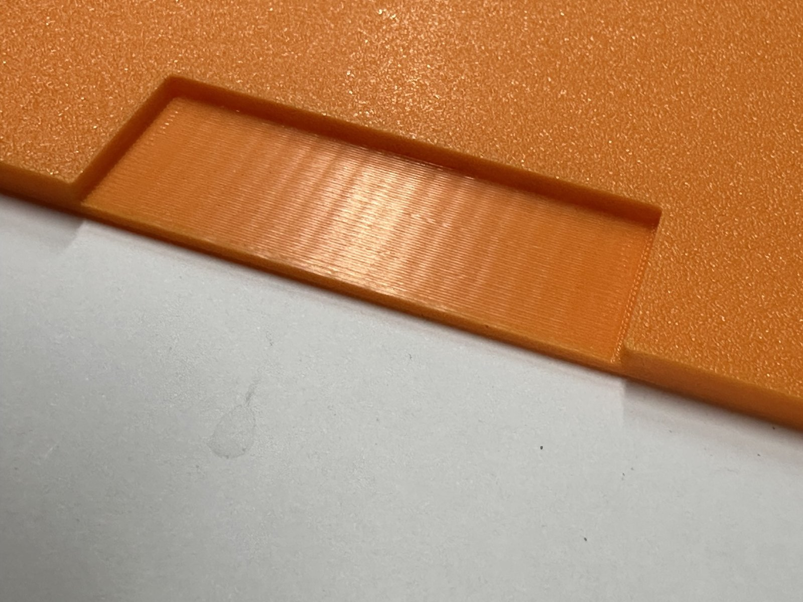

# Printing

*This chapter is an outline, still to be written. It will cover:*

- Slicer settings that matter: walls, infill, bridging, and brims.
- The base halves: orientation and what to expect.
- Extensions: printed upright with supports under the lips.
- Print plates: `part = "all"` gives every part of the build in print
  orientation, grouped into plates for your `printer_size` and
  `printer_margin`; `print_plate = N` gives plate N on its own. The console
  lists the plates and which need supports.
- Lids: printed top face down. Print `lid_hinge_test` first to check the
  snap-in hinge in your filament.
- Extension pegs (`part = "ext_pegs"`): printed lying down, never standing
  up; print a few spares.
- Printed hinges (`part = "printed_hinges"`, in PETG): two blocks printed
  upright and two arms standing on their front faces, so the pin's hole is
  vertical and the pin's load lies along the layers; no supports. The
  pivot holes are teardrops with their points up.
- Trim strips (`back_trim`, `left_trim`) print flat on their undersides,
  and `cord_slot_trim` upright, all without supports.
- Features removed after printing: knock-out walls under the handholds, sacrificial membranes over screw holes.

> **Note: lid hinges in PLA and PETG.** The hinge defaults
> (`lid_tab_w = 4`, `lid_bump_engage = 1.0`) come from test prints in both
> PLA and PETG. With the narrower 2.5 mm flex tabs of earlier versions, a PLA
> lid popped out of its hinge almost every time it was opened: PLA is stiffer
> than PETG and the narrow tab bowed away instead of holding the bump in. If
> a lid still comes out too easily, tighten `lid_hinge_end_clearance` or make
> the bumps steeper with a smaller `lid_bump_angle`; if it is hard to snap
> in, do the opposite. Try changes on `lid_hinge_test`, which prints in a
> few minutes, before printing a full lid.

> **Note: supports under the lips and trenches.** The extension lips and the
> bobbin-plate trenches in the lids need supports. Standard (not tree)
> supports, with a separate support material printed on the interface
> layer, give a clean underside: the trench floor below was printed over
> them, in a lid printed top face down so the top takes the bed's texture.
> On a printer with a second material, the slicer adds a purge tower to
> each plate with supports; leave room for it.

{width=60%}

> **Note: one supported layer per part.** Where a part needs supports, the
> model keeps its supported surfaces on a single layer, so a printer without
> an automatic material changer needs only two filament changes for the
> support material: one before the interface layer and one after. The lid
> with a bobbin trench and the extension lips each have one such layer. (The
> old molded extension pegs added a second, which is one reason the separate
> pegs are better.) Two supported parts share a plate only when their
> interfaces are on the same layer, and the plate keeps a corner clear for a
> purge tower (`purge_tower_size`). The console warns about any part with
> supports on more than one layer.
