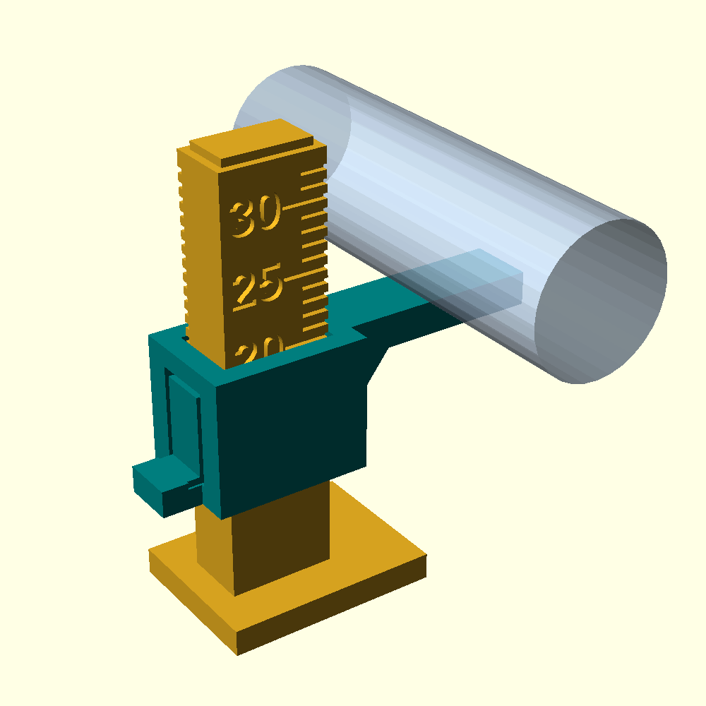

# Optical shaft encoder: a concept

*Drawn by Claude at Bob Drzyzgula's direction, October 2026. A concept
to look at and argue with. It is not a finished design and has not been
built.*

This is the optical alternative from the motor-control paper's "Fitting the
encoder" (§11), sized for a Kenmore 158's arm shaft. The shaft measures about 12.25 mm
(an earlier, rougher figure was 11 mm), and its underside is 20 mm above
the casting floor, measured with the gauge below and confirmed with
calipers, which puts the axis about 26.1 mm up. The
measurements behind it are about 5–10 mm of clear shaft at the candidate
spots, with room for a ring of up to about 40 mm diameter (50 mm in places).
`optical_encoder_concept.scad` models it. Its parts are `assembly`,
`exploded`, and the two printed parts, `ring_half` and `bracket`.

## How it works

**The ring** is a printed disc, 40 mm across, with 36 open-ended slots
around its rim, like a comb. It is split through the shaft's axis, so the
two halves clamp on from either side without taking the shaft out. Two M2
screws run across the split, through a hub on one side of the disc. The
split falls in a slot, so no tooth is cut. The hub is the part that grips,
and it could equally clamp over an existing collar. Hub and disc together
are about 7 mm long along the shaft.

**The forks** are two slotted photo-IC interrupters, each with an infrared
LED in one arm and a detector with a logic output in the other. The disc's
rim runs through their slots, so each one sees the light cut on and off as
the teeth pass. The two forks are 42.5° apart, which is 4¼ slot pitches.
That puts their signals a quarter-cycle out of step: quadrature. The order
in which the two change gives the direction, and counting every edge of
both gives four counts per slot, **144 counts a turn, 2.5° each**. A
12-magnet Hall ring gives 24.

**The index** comes from a Hall switch working alongside the optics, as Bob suggested, and it works well. One magnet
sits in a small boss on the disc's face, inside the radius the forks reach,
and a Hall switch on the bracket reads it once a turn from about a
millimeter away. Mixing the two technologies has two advantages. The index
doesn't depend on the optics staying clean. And because the index comes
round once a turn, the firmware can check that the count is still 144
since the last index. If it isn't, a fork is fouling or missing edges, and
the controller can say so instead of stopping in the wrong place.

**The bracket** is a printed arc that sits under the ring. Each fork drops
into a pocket on the arc's inner face, with its leads passing out through
the arc. A finger rises beside the disc to carry the Hall switch. An arm
runs down to a tab with one screw and a vertical slot:
- sliding the slot sets how deep the forks sit over the teeth;
- turning the bracket about the screw trims its angle.

The anchor in the model is a stand-in, a face of the casting square to the
shaft with a tapped hole. On a real machine it would be whatever the casting
offers.

## Cleaning

The slots are open at the rim, so a brush or a puff of air clears them.
Once the top cover is off, the forks' slots face the shaft and can be
reached. The ring comes off with two screws, and the forks lift out of
their pockets. Nothing here holds oil. A wipe of the forks and ring can
then join the regular oiling and cleaning.

## What the concept does not settle

- **The fork part.** The model's fork is generic: 10 mm along the shaft,
  4.5 mm across, a 3 mm slot 6 mm deep. Real photo-IC interrupters vary.
  The one chosen fixes the pocket sizes, and its aperture fixes how fine
  the slots can be. A single dual-channel fork, with both detectors in one
  body, would save space and fix the quadrature spacing. It would also need
  the slot pitch to match its detector spacing.
- **Axial room at the rim.** The forks are longer along the shaft than the
  ring is thick, so the room that counts is the clear length at the ring's
  outer radius, not only at the shaft.
- **Supply and leads.** The LEDs draw 10–20 mA each, so they run from 5 V
  with a resistor each. The lead path inside the casting, clear of moving
  parts, is per machine.
- **Runout and end play.** The disc must stay centered in a 3 mm slot
  through a full turn, and its teeth must stay over the apertures. Checking
  the bracket's adjustment against the shaft's actual play is a job for the
  bench.
- **Slot count.** 36 slots at 40 mm leaves teeth and slots about 1.6 mm
  wide at the apertures. More slots need a finer aperture, a larger ring,
  or both.

## Measuring the shaft's height: `shaft_height_gauge.scad`

A small printed slide gauge for measuring from the casting floor to the
underside of the shaft, where calipers won't fit. A foot stands on the
floor, with an upright rail engraved in millimeters (12–32 mm) on both
faces. A slider rides the rail, and its flat arm reaches under the shaft. A
sprung pad cut in the slider's back wall holds it wherever it's left. Push
the slider up by its tab until the arm just touches the shaft; the reading
is the scale mark level with the slider's top edge. For a better number,
lift the gauge out without disturbing the slider and measure from the
bottom of the foot to the top of the arm with calipers. Print the base
standing up, and the slider upside down, with the arm's measuring face on
the bed.

## Finding the bore: `shaft_fit_collars.scad`

The shaft is turned down in places and needn't be a standard size, so the
ring's bore is found by trial. The model prints a set of snap-on C-clip
collars, each with its bore engraved on a tab. You set the middle size, the
step and the number of collars, so the search narrows round by round: 0.25 mm
steps, then 0.1, then 0.05. Push each collar onto the shaft where the ring
will sit. Too small won't seat or sits proud; too large turns freely; the
right one snaps on and turns with light drag. Because the collars measure
what your printer actually makes, print the final ring in the same filament
and the same orientation, bore vertical and flat on the bed.
