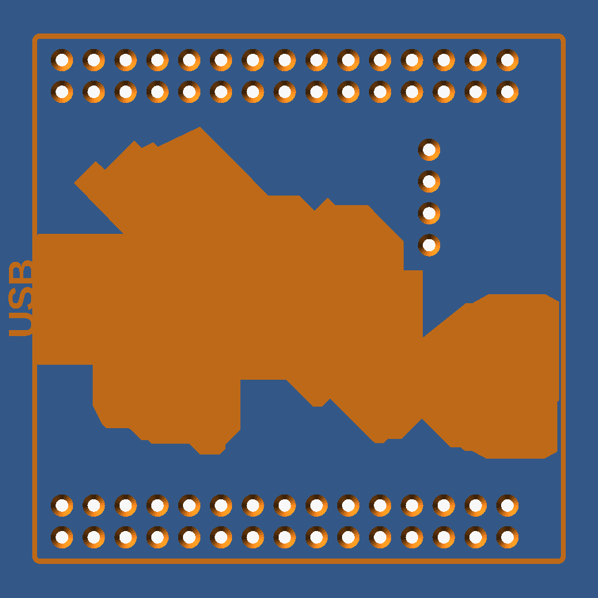

# Header soldering stand for the RP2350B controller board



*Written by Claude at Bob's direction.*

This is a 3D-printed jig for soldering generic 0.1" male pin headers onto the RP2350B board used in the motor controller. It holds every pin vertical and parallel while you solder, so the headers come out straight. The board is defined by `3D_RP350B.step`, an EasyEDA Pro export. It isn't kept here. It comes from WeAct Studio's repository, <https://github.com/WeActStudio/WeActStudio.RP2350BCoreBoard>, and is needed only to regenerate the data file.

## Files

| File | What it is |
|---|---|
| `rp2350b_header_stand.scad` | OpenSCAD model. You can adjust all parameters in the Customizer. |
| `rp2350b_data.scad` | Pin positions, board outline and component outlines extracted from the STEP file. It is included by the main file and must be in the same folder. |
| `rp2350b_stand_body_bottom.stl` | Stand for mounting the header plastic **under** the board (normal mounting). Built with the commands under "Parameters"; STLs aren't kept in the repository. |
| `rp2350b_stand_body_top.stl` | Stand for mounting the header plastic **on the component side**. Built the same way. |
| `rp2350b_stand_body_top_preview.png` | A render of the body-top variant. |
| `extract_step_to_scad.py` | Regenerates `rp2350b_data.scad` from the STEP file if the board changes. |

## The board, as read from the STEP file

- The board is 41.4 × 41.1 mm and 1.6 mm thick. All components are on the top side, and the bottom is bare.
- **Header holes** (1.1 mm drill, 2.54 mm pitch):
  - two 2×15 rows, one along the top edge and one along the bottom edge. They are symmetric about the board's horizontal centerline.
  - one 1×4 column near the center at x = 31.09 mm, just right of the RP2350B chip.
- There are four 2.26 mm mounting holes, one in each corner. The stand doesn't use them.
- **Tallest top-side parts:** the USB-C connector sticks up 3.2 mm above the board, and the three tact switches stick up 2.5 mm. Everything else is 1.75 mm or less.

## Stand design

- **Holes:**
  - 1.0 mm through holes, which give clearance over the 0.9 mm diagonal of a square 0.64 mm pin.
  - The block is 8 mm thick. The holes go all the way through, so long-pin headers never bottom out.
  - Each hole has a 0.4 mm chamfer at the top so pins drop in easily, and a 0.3 mm chamfer at the bottom to offset elephant's foot.
- **What sets the alignment:** the depth of the holes keeps the pins parallel. The board rests only on the plastic header bodies, which keeps it square to the pins.
- **Size and markings:**
  - The stand extends 4 mm past the board outline on every side and has rounded corners.
  - The board outline is engraved on the top face, and a "USB" mark shows which end the USB-C connector goes.
  - The front face is engraved with the variant: "BODY BOTTOM / PARTS UP" or "BODY TOP / PARTS DOWN".
- **Component-side variant (`body_side = "top"`):**
  - The board goes in upside down. That mirrors the pin pattern about the board's horizontal centerline. The outer rows land in the same places, but the 1×4 column moves.
  - The top face is pocketed under the components. The pocket depth is the tallest part (3.2 mm) minus the header body height (2.5 mm), plus 1 mm of clearance, which comes to 1.7 mm.
  - The pocket follows each part's actual outline from the STEP file plus 0.75 mm. Pockets closer than about 5 mm apart are merged, so there are no thin slivers.
  - At least 0.75 mm of solid surface is kept around every header body, including the middle column, so each body sits on a flat surface.

## Printing

- Print with the top face up so the holes are vertical. No supports are needed.
- Use at least 0.2 mm layers. Several perimeters around the holes help.
- If pins bind in the holes, the printer is making holes undersized. Set `hole_d = 1.1` and re-export, or run a 1.0 mm drill through the holes. Pins should drop in freely without wobbling.

## Using the stand

1. **Choose the variant.**
   - **Body bottom:** the usual Pico-style mounting, with the plastic under the board and the long pins pointing down out of the bottom.
   - **Body top:** the plastic and long pins are on the component side, for when the board plugs into a carrier component side down.
2. **Load the headers.** Snap or cut header strips to 2×15, 2×15 and 1×4. Push them into the stand with the **long pins down**, until each plastic body sits flat on the stand's top face.
3. **Place the board** over the short pins.
   - **Body bottom:** components face up, and the USB connector goes toward the "USB" mark.
   - **Body top:** components face down into the pockets. The USB connector still goes toward the "USB" mark. The board sits on the header bodies and should not touch the stand anywhere else.
4. **Tack, check, then solder.**
   - Solder one corner pin of each header, then the diagonally opposite corner.
   - Check that the board is flat and seated on all the header bodies. If something is off, reheat a tack joint and press the board down.
   - Then solder the rest of the pins.
   - Keep each joint short, about 2 seconds, and skip around the board rather than going down a row in order. If heat builds up, the plastic bodies soften and the pins can tilt as they cool.
5. **Remove the board.** Lift it straight up off the stand.

**Known close fit (body-top variant only):** a 0402 capacitor sits right next to the 1×4 header body, at about (29.3, −23.4) in board coordinates. At the nominal 2.54 mm body width their outlines overlap by 0.02 mm. Real header bodies are about 2.5 mm wide and just clear it. The capacitor is only 0.5 mm tall, so it can't reach the stand, but you may need to nudge the header slightly away from it before tacking.

## Parameters (`rp2350b_header_stand.scad`)

| Parameter | Default | Meaning |
|---|---|---|
| `body_side` | `"bottom"` | `"bottom"` or `"top"`: which side of the board the header plastic goes on |
| `hole_d` | 1.0 | Pin hole diameter |
| `stand_h` | 8.0 | Stand thickness, which is also the hole depth |
| `margin` | 4.0 | How far the stand extends past the board outline |
| `countersink` / `bottom_chamfer` | 0.4 / 0.3 | Hole entry chamfers |
| `header_body_h` | 2.5 | Height of the header's plastic body. It sets the pocket depth. |
| `pocket_xy_clr` | 0.75 | Clearance around each component outline |
| `pocket_extra_z` / `pocket_min` | 1.0 / 1.0 | Extra pocket depth / minimum pocket depth |
| `merge_gap` | 2.5 | Pockets closer than about twice this are merged |
| `keepout` | 0.75 | Solid margin kept around each header body |
| `show_board` | false | Shows a ghost of the board, header bodies and components in preview. It isn't part of the export. |

To export from the command line:

```sh
openscad -D 'body_side="bottom"' -o rp2350b_stand_body_bottom.stl rp2350b_header_stand.scad
openscad -D 'body_side="top"'    -o rp2350b_stand_body_top.stl    rp2350b_header_stand.scad
```

## Regenerating the data if the board changes

When the PCB is revised, export a new STEP file from EasyEDA and run:

```sh
pip install --break-system-packages "cadquery-ocp<7.9"
python3 extract_step_to_scad.py 3D_RP350B.step rp2350b_data.scad
```

- **Use the 7.8 bindings.** Version 8.x of `cadquery-ocp` changed the Python API, and the script won't run on it.
- **What the script does:** it reads the board solid's vertical cylindrical faces to get the hole positions, and meshes each component to get its 2D convex outline and height.
- **Built-in assumptions:**
  - the header drill is 1.1 mm
  - the mounting-hole drill is 2.26 mm
  - the middle column is at x = 31.09 mm
  - the board top is at z = 1.6 mm

  If the layout changes, edit the constants at the top of the script (`HEADER_D`, `MOUNT_D`, `MID_X`, `BOARD_TOP`).
- **If the hole pattern stops being symmetric** about the horizontal centerline: the body-top variant's mirroring still works, but the outer rows will no longer land where they were.
