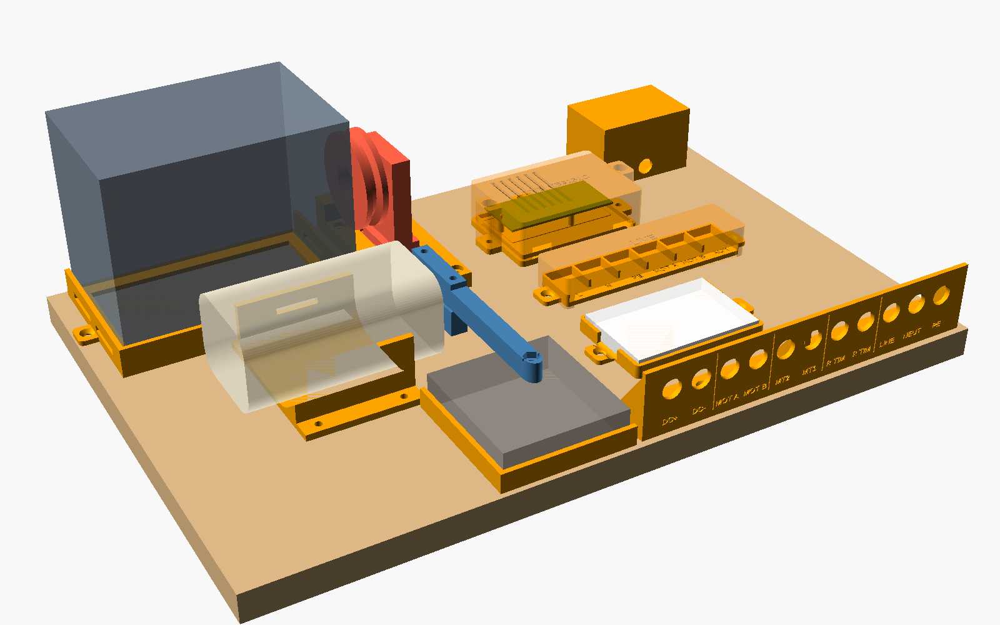

# Sewing-Motor Test Rig: User's Guide

*Written by Claude at Bob Drzyzgula's direction, October 2026. Draft 1.*

The rig is a plywood board carrying 3D-printed modules for two jobs:

1. **Characterizing a universal sewing-machine motor**: winding resistance,
   inductance, speed against voltage and current, and torque. These figures
   feed the speed estimate in the Gen 2 controller's firmware.
2. **Studying the KB3151C triac board**: how firing angle, speed and load
   respond to the timing resistance, with a decade box in place of the
   board's slide pot.

All dimensions are in millimetres unless stated otherwise. Part names in
`code` are the `part` values in `motor_rig.scad`.

---

## 1. Safety first

With mains connected, these parts are **live at 120 V**:

- the triac board, including its heatsink tab (MT2);
- the Wago blocks;
- the MT2, MT1, R TIM, MOT A, MOT B, LINE and NEUT sockets;
- the decade box, whose binding posts sit on the R TIM sockets;
- the breadboard, if anything on it is wired into the mains side.

Rules:

1. **Change any connection with the rig's IEC cord unplugged.** Plug in last,
   unplug first.
2. **One source at a time.** Never connect the DC bench supply while the IEC
   cord is plugged in. Mains on the motor terminals will destroy the supply.
3. **The scope goes on the AC side only through the isolation transformer,
   and then with its ground clip on a single node.** The scope's ground clip
   is earthed: on an un-isolated rig it shorts whatever it touches to earth.
   Two probes need their grounds on the *same* node.
4. **The isolation transformer is not a safety device for your hands.** It
   stops current flowing to earth. It does nothing about touching two live
   points at once.
5. **Keep the lids on** the triac board, the Wago blocks and the breadboard
   whenever the cord is plugged in.
6. **The decade box must be rated for at least 200 V**, and each resistor for
   at least 0.3 W. Change its setting only with the cord unplugged.
7. **The brake and load stand get hot.** Keep each loaded point to 10–20
   seconds and let them cool between points.
8. **Strap the motor down** before every run. Its starting torque will roll
   it in the cradle.

---

## 2. What's on the board

| Module | Part(s) | Where | Purpose |
|---|---|---|---|
| Motor cradle | `motor_cradle.scad` | left front | Foam-lined saddle, strapped |
| Prony brake | `prony_brake.scad` | on the motor pulley | Torque, read on a scale |
| Scale fence | `scale_fence` | in front of the pulley | Locates the scale under the brake arm |
| Load stand | `load_rail`, `load_carriage`, `load_pulley`, `load_spacer`, `drag_plunger` | behind the pulley | Belt load, adjustable felt drag |
| Isolation transformer holder | `iso_holder` | back left | Holds a Hammond 171B (200 VA) |
| Triac board mount | `board_plate`, `board_cover` | right middle | KB3151C on its three posts |
| Wago holder | `wago_holder`, `wago_lid` | right middle | Six fixed junctions |
| Breadboard | `bb_tray`, `bb_lid` | right front | Low-voltage experiments; DC rails from the panel |
| IEC inlet | `iec_box` | back right | Fused C14 mains entry |
| Jack panel | `jack_panel` | front edge | All configuration is done here with banana leads |

---

## 3. Building it

### 3.1 Before printing, measure and set

In the OpenSCAD Customizer:

| Parameter | File | Default | Check against |
|---|---|---|---|
| `corner_r` | `motor_cradle.scad` | 14 | Motor body's corner radius |
| `pulley_d`, `pulley_w` | `prony_brake.scad` | 19, 10 | Motor pulley |
| `breadboard` | `motor_rig.scad` | 82.5 × 54.6 × 8.5 | Your breadboard |
| `jack_hole` | `motor_rig.scad` | 12.2 | Your sockets' panel hole |
| `scale_size` | `motor_rig.scad` | 75 × 80 | Your scale's footprint |
| `iso_size` | `motor_rig.scad` | 141.2 × 96.5 × 118.9 | Transformer case |

### 3.2 Print list

PETG for anything that carries load or heat, PLA for the rest. No part needs
supports, and each STL is already oriented for printing. To see every part at
once, render `motor_rig.scad` with `part = "all"`: all of them, the motor
cradle and the brake's jaws included, laid out in print orientation (an
overview and checklist; they won't all fit one bed).

| STL | Qty | Material | Notes |
|---|---|---|---|
| `motor_cradle` | 1 | PETG | |
| `prony_brake_plate` | 1 | PETG | Both jaws on one plate |
| `load_rail`, `load_carriage` | 1 each | PETG | Test the dovetail slide before fitting the hardware |
| `load_pulley` | 1 | PETG | Press in two 608 bearings |
| `load_spacer`, `drag_plunger` | 1 each | PETG | |
| `scale_fence` | 1 | PLA | |
| `iso_holder` | 1 | PETG | |
| `board_plate`, `board_cover` | 1 each | PETG | The cover prints roof-down |
| `wago_holder`, `wago_lid` | 1 each | PLA or PETG | |
| `bb_tray`, `bb_lid` | 1 each | PLA | |
| `iec_box` | 1 | PETG | Prints panel-down |
| `jack_panel` | 1 | PETG | Prints face-down, 220 mm long |

**Notes on filament choices.** Nothing on the rig is loaded anywhere near
the strength of any common filament, so the choice comes down to heat,
and to which parts carry mains.

- **What the filaments stand.** As a rough guide, PLA starts to soften at
  about 55 °C. PETG holds its shape to about 70 °C (its heat deflection
  temperature at light load), and ASA and ABS to about 90 °C. PC and
  PC blends go higher still. Carbon- or glass-filled grades are stiffer
  and gain a few degrees, but they wear brass nozzles and add nothing the
  rig needs.
- **The brake jaws: the hottest parts.** The brake turns the motor's
  output into heat at the pulley, and the jaws hold the pulley through
  their felt pads. With the duty cycle in §7 (10–20 seconds per loaded
  point, then a pause to cool), PETG stays well inside its range. Feel
  the jaws after a few points: if they're too warm to hold comfortably,
  wait longer between points. For long runs at heavy loads, print them in
  ASA or PC.
- **The motor cradle.** A sewing motor's case runs warm rather than hot
  in short tests, and the felt lining insulates it a little; PETG is
  enough. A motor run hard for many minutes can get hotter. Then ASA, or
  simply letting it cool, is the answer.
- **The load pulley and its plunger.** Bearing friction warms them only a
  little. A slipping belt warms the pulley's groove, so tension the belt
  rather than letting it slip.
- **The parts near mains.** The triac board's plate and vented cover, the
  IEC box, the jack panel and the Wago holder carry or cover live parts.
  The heat is modest: the triac dissipates about a watt at these
  currents. Use PETG or better, not PLA, so that a warm day or a warm
  triac can't let a screw loosen or a cover sag toward a live part. No
  common filament is flame-rated as printed, so the fused inlet, the lids
  and the rule of changing connections only with the cord unplugged are
  what keep these parts safe, not the plastic.
- **The rest.** The scale fence, the breadboard tray and lid, and the
  isolation transformer's holder see little heat. PLA is fine for the
  fence and the breadboard parts. The holder is listed as PETG because it
  bears the transformer's weight on a bench that may get warm, but PLA
  would serve.

In short: PETG for everything is a sound default, with ASA or PC for the
brake jaws if they will see long, heavy runs.

### 3.3 Hardware

| Item | Qty | For |
|---|---|---|
| 18 mm plywood, 450 × 300 | 1 | Base |
| #8 × 5/8" wood screws | about 24 | Modules to the plywood |
| #8 × 1-1/2" wood screws | 2 | Through the board cover's ears |
| M4 × 50 bolt, washer, light spring, wing nut | 2 | Brake clamp |
| M5 × 30 screw and nut | 1 | Brake contact screw |
| Stick-on felt, 2 mm | — | Brake jaws, drag plunger |
| M8 × 50 bolt, nut, nyloc nut, washers | 1 | Load pulley axle |
| 608 bearings | 2 | Load pulley |
| M5 × 40 screw, nut, washer | 1 | Belt tension |
| M6 × 30 screw and nut | 1 | Drag |
| Compression spring, about 8 mm OD × 12 mm (optional) | 1 | Smoother drag adjustment |
| M3 heat-set insert, M3 × 6 screw, washer | 1 | Triac board |
| Wago 221-413 | 6 | Junctions |
| IEC C14 fused inlet (52.5 × 27.5 cutout) | 1 | Mains entry |
| 4 mm shrouded panel sockets | 11 | Jack panel; red and black for DC+/DC− |
| 4 mm safety banana leads | 6–8 | Patching |
| 4 mm shorting plugs (optional) | 2 | Spare links |
| Hook-and-loop strap, 25–30 mm | 2 | Motor, transformer |
| V-belt or round belt, 240–315 mm | 1 | Motor to load pulley |
| Half-size breadboard | 1 | |
| Hammond 171B isolation transformer | 1 | When the scope goes on the AC side |

### 3.4 Assembly

1. **Mark the plywood.** Print `rig_template.svg` at 100% scale, tiled
   across sheets. Tape it down, and centre-punch each hole. Drill 3 mm pilots.
   Lightly round the plywood's edges.
2. **Mechanical modules.**
   - Line the cradle with foam, then screw it down.
   - Screw down the scale fence and the transformer holder.
   - Screw the load rail down with its screw block at the back.
3. **Load stand.**
   - Press the two 608 bearings into the pulley.
   - Bolt it to the carriage's upright: bolt head and nut in the hex pocket on
     the outside, then the spacer, then the pulley, then a washer and the
     nyloc nut. Snug the nyloc nut, but don't preload the bearings.
   - Drop the M5 nut into the carriage's side pocket. Slide the carriage into
     the rail and run the tension screw in from the back.
   - Felt the plunger's end and fit it (spring behind it, if used) into the
     square bore. Run the M6 drag screw in from the outside until it just
     touches the plunger.
4. **Triac board.**
   - Melt the heat-set insert into the plate's screw boss and screw the plate
     down.
   - Desolder VR1 (already done), seat the board over the peg and posts, and
     fit the M3 screw and washer.
   - Fit the cover last, with the long screws through its ears.
5. **Electrical modules.** Screw down the IEC box, the Wago holder, the
   breadboard tray and the jack panel. Mount the sockets in the panel
   (red DC+, black DC−).
6. **Permanent wiring.** Use 18 AWG stranded wire, 300 V rated or better,
   with ferrules on the ends going into Wago blocks. See section 4.
7. **Check before first power.** With the IEC cord unplugged and nothing
   patched, check with the ohmmeter that:
   - no socket is connected to PE except PE itself;
   - LINE to NEUT is open.

---

## 4. Permanent wiring

The Wago blocks and the triac board are wired once. Every configuration
after that is done with banana leads at the jack panel.

| From | To | Notes |
|---|---|---|
| IEC inlet L (fused) | Wago **L** | |
| IEC inlet N | Wago **N** | |
| IEC inlet PE | Wago **PE** | |
| Wago L | **LINE** socket | |
| Wago N | **NEUT** socket | |
| Wago PE | **PE** socket | Also any exposed metal you add |
| Motor lead A | Wago **MOT A** → **MOT A** socket | The motor's own cord, through whatever adapter its plug needs |
| Motor lead B | Wago **MOT B** → **MOT B** socket | |
| Triac board tab J1 (MT2 side) | **MT2** socket | 6.3 mm female spade on the board end |
| Triac board tab J2 (MT1 side) | **MT1** socket | 6.3 mm female spade |
| Old VR1 pad, pin 2 (wiper) | **R TIM** socket, left | |
| Old VR1 pad, pin 1 | **R TIM** socket, right | Leave pin 3 open: that takes RV2 out of circuit |
| **DC+**, **DC−** sockets | Breadboard power rails | Bench supply into the breadboard only |
| Wago **AUX** | — | Spare |

Wire paths: the triac board leads leave the cover through the notches at its
front corners. The R TIM leads leave through the notch at the back left.

---

## 5. Configurations

Patch with the IEC cord unplugged. Plug in last.

### 5.1 Mains source options

| Setup | Chain | Use it for |
|---|---|---|
| Direct | Wall → Kill-A-Watt → rig IEC cord | Meter readings only |
| Isolated | Wall → 171B input; 171B output → Kill-A-Watt → rig IEC cord | Any scope work on the AC side |

With the transformer in the chain, the Kill-A-Watt reads only the rig's
power, not the transformer's losses.

### 5.2 Patch tables

**A. DC motor tests** (IEC cord unplugged and set aside)

| Lead | From | To |
|---|---|---|
| Red | Bench supply + | MOT A |
| Black | Bench supply − | MOT B |
| Optional | Meter in series in the red lead (A range) | |

**B. AC, full line** (one top-end point)

| Lead | From | To |
|---|---|---|
| 1 | LINE | MOT A |
| 2 | MOT B | NEUT |

The motor runs at full speed the moment the cord goes in. Hold the strap.

**C. AC through the triac board** (the controller study)

| Lead | From | To |
|---|---|---|
| 1 | LINE | MT2 |
| 2 | MT1 | MOT A (meter in series here for current, true-RMS A range) |
| 3 | MOT B | NEUT |
| 4, 5 | Decade box | R TIM pair |

**Scope on C** (isolated setup only): clip the ground to **MT1**.

- Channel 1 on **MT2** shows the voltage across the triac. It drops to near
  zero at the firing point.
- Channel 2 on **MOT B** shows the motor's terminal voltage, inverted. Use the
  scope's invert function.
- For current, add a 1 Ω, 5 W resistor in lead 3 and measure across it, with
  the ground moved to the resistor's MOT B end. One ground node at a time.

---

## 6. Mechanical adjustments

### 6.1 Prony brake

1. **Pick the side.** Run the motor briefly with no load and note its
   rotation. Fit the brake with its arm on the side where the pulley's
   surface moves *down*, over the scale. To change sides, turn the brake end
   for end.
2. **Level the arm.** Set the scale in the fence, then adjust the M5 contact
   screw until the arm is level with the jaws seated on the pulley.
3. **Zero the scale** with the motor stopped and the arm resting on it. The
   arm's own weight drops out of every later reading.
4. **Load it** by tightening both wing nuts evenly, a quarter turn at a time.

**Torque (N·m) = scale reading (kg) × 9.81 × 0.100**

### 6.2 Belt load stand

1. Slide the motor along the cradle until its pulley groove lines up with
   the load pulley's groove (X ≈ 181 on the template).
2. Fit the belt and tension it with the screw at the back: about 5 mm of
   deflection under light finger pressure.
3. Set the drag with the M6 screw. The felt plunger bears on the pulley's
   face at 21 mm radius.

The stand gives a repeatable load, rather like the belt drive to a sewing
machine. For a torque *reading*, use the prony brake on the motor pulley
instead. The two can't share the pulley at the same time.

### 6.3 Tach

Put a strip of reflective tape on the motor pulley's outer face. Aim the
tach along the motor's axis from beyond the pulley end, where the board is
kept clear.

---

## 7. Test procedures

Write down the room temperature and the motor's identity at the start of
every session.

### 7.1 Winding resistance (setup A)

1. Set the supply to constant current, 0.5 A. Hold the pulley still.
2. Read the voltage at MOT A / MOT B with the Fluke. **R = V / I.**
3. Repeat at 8 rotor positions, turning the pulley a little each time.
   Record the minimum, maximum and mean.
4. Repeat right after a 5-minute run to get the hot value.

### 7.2 Inductance (setup A, scope allowed: the supply floats)

1. Put a 1 Ω resistor in series and lock the rotor.
2. In constant-voltage mode, set the voltage that gives about 0.5 A, then
   switch the supply's output on. Capture the current rise across the
   resistor.
3. Read the time constant τ, the time to reach 63% of the final current.
   **L = τ × (R + 1 Ω).**

### 7.3 DC speed map (setup A)

Step from 5 V to 30 V in 2.5 V steps. Run no load, then at two prony-brake
settings.

| V | I (A) | RPM | Scale (g) | Torque (N·m) | E = V − I·R | kΦ = E / ω |
|---|---|---|---|---|---|---|

ω = RPM × 2π / 60. In a series motor kΦ depends on current, so plot kΦ
against I. The brake gives a second check: **T ≈ kΦ · I**. If the torque and
back-EMF curves agree, the firmware's speed estimate rests on solid ground.

### 7.4 Top-end AC point (setup B)

Record the Kill-A-Watt's V, A, W and PF, and RPM, with no load. Then
**E ≈ (P − I²R) / I**.

### 7.5 Triac board sweep (setup C)

1. Set the decade box, plug in, read, unplug. Repeat.
2. Use steps of 10 kΩ from 0 to 100 kΩ, then 2–5 kΩ until the motor stops.
3. **Sweep both ways.** Coming down from "off", the motor starts at a lower
   R than where it stops on the way up: that's the diac's snap-on
   hysteresis. Note both points.
4. Repeat the sweep with no load, then at one or two fixed brake or drag
   settings.

| R (kΩ) | Direction | RPM | V | A | W | PF | Scale (g) | Firing angle (°, scope) |
|---|---|---|---|---|---|---|---|---|

For reference, a simple model of the board (0.1 µF timing capacitor, 1 kΩ
R2, DB3 diac breaking over at about 32 V, motor effects ignored) predicts:

| R box | Fires at | Motor V (RMS, % of line) |
|---|---|---|
| 0 | 13° | ~100% |
| 20 kΩ | 52° | 93% |
| 40 kΩ | 77° | 80% |
| 60 kΩ | 95° | 67% |
| 80 kΩ | 109° | 54% |
| 100 kΩ | 123° | 41% |
| 120 kΩ | 139° | 26% |
| ~135 kΩ and up | no firing | 0 |

The motor's inductance and back-EMF will move these numbers. The measured
cutoff resistance sets RV2 in the Gen 1 knee controller.

---

## 8. Troubleshooting

| Symptom | Likely cause |
|---|---|
| Motor doesn't run in setup C at any R | Decade box open or on the wrong range; R TIM leads on pin 3 instead of pins 1 and 2; or a failed diac or triac. The board itself works either way round between MT2 and MT1 |
| Motor runs full speed whatever R is | The triac has failed short. Check MT2 to MT1 with the cord unplugged |
| Brake reading jumps about | Felt glazed (scuff it or replace it), jaws not tightened evenly, or the arm touching the fence |
| Belt slips at light load | Tension it, or check the groove alignment |
| Load-stand drag grabs | Plunger binding in its bore; ease the bore, or fit the spring |
| Kill-A-Watt PF reads oddly in setup C | Expected: phase control distorts the current. Use its W reading, not V × A |
| Scope trace shows a large hum or ground fault | Scope used without the isolation transformer, or two grounds on different nodes. **Stop and re-patch.** |

---

## 9. Files

| File | What it is |
|---|---|
| `motor_rig.scad` | The rig: layout, template and every rig part |
| `motor_cradle.scad`, `prony_brake.scad` | Cradle and brake, used by the rig file |
| `rig_template.svg` | 1:1 drilling template for the plywood |
| `rig_iso.png` | Layout preview |
| [`../triac-board/KB3151C.kicad_sch`](../triac-board/KB3151C.kicad_sch) | The triac board's traced schematic |

The repository doesn't carry STL files; export each part from
`motor_rig.scad` (or `prony_brake.scad`) by setting `part` and rendering.
