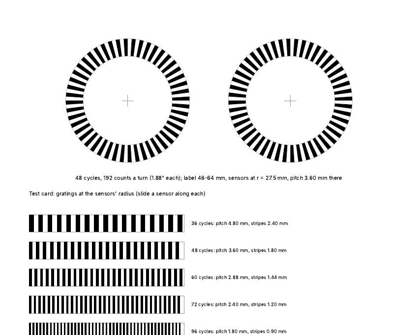

# Reflective hand-wheel encoder: a concept for the Singer 99K

*Drawn by Claude at Bob Drzyzgula's direction, November 2026. A concept to
print and try. It has not been built.*

The 99K's arm is sealed cast iron, so its shaft can't take a ring, and the
encoder goes on the hand wheel (motor-control paper, "Fitting the encoder").
Here a printed annulus of black and white stripes is stuck to the flat part
of the wheel's back face, and two reflective sensors read it from a small
printed head. The index comes from a magnet on the link under the bed that
swings once a stitch.

This folder covers the parts that touch the encoder: the label, the head,
a jig for centering the label, and how the index could work. How the head
is held in place is left for a bracket designed later. It attaches to the
head's back face by two heat-set inserts.

## The label

`make_label.py` draws it, full size, on a letter page: two labels (one
spare), a test card, and scale bars to check the print.

    hardware/reflective-encoder/make_label.py --id 45 --od 65 --cycles 48

- **Size.** The 99K's flat annulus measures 45 mm inside and 65 mm outside.
  The label is 1 mm smaller each way, 46 to 64 mm, so its edge never sits
  on a fillet.
- **Stripes.** 48 black and white pairs a turn by default, radial, so each
  stripe is half the pitch at every radius. The two sensors read at the
  middle radius, 27.5 mm, where the pitch is 3.6 mm and each stripe 1.8 mm.
  Counting every edge of both channels gives four counts per pair: **192
  counts a turn, 1.875° each**, against 24 for a 12-magnet Hall ring.
- **The sensor sets the limit, not the printer.** A reflective sensor sees
  a spot, and stripes much narrower than the spot blur together. The test
  card has straight gratings at the pitch the track would have for 36, 48,
  60, 72 and 96 cycles, with solid white and black patches beside them.
  Slide a sensor along each at the gap you mean to use, and watch its output.
  The finest grating that still swings well between the white and black
  levels sets `--cycles`.
- **Printing.** Use a laser printer on matte white polyester or vinyl label
  stock with removable adhesive. Toner is carbon black, which absorbs
  infrared; many inkjet blacks look nearly white to an infrared sensor, so
  test an inkjet print on the card first. Matte, because a glossy surface
  throws glints. Polyester or vinyl, because paper soaks up oil and
  changes its reflection. Removable adhesive, for the japanning.
- **Cutting.** A thin gray circle at each edge is the cutting line. A dotted
  circle marks the sensors' radius.

## Centering the label

An off-center label puts the count out of step with the wheel and moves the
two channels' quarter-cycle spacing around the turn. The `jig` part centers
it, with the wheel off the machine and its back face up. A spigot fits the
wheel's bore (`wheel_bore`, to measure), under a disc that fits the label's
hole. If a hub boss stands up inside the annulus, `hub_boss` gives it a
pocket. Seat the jig, drop the label over the disc, press it down from the
jig outward, and lift the jig out.

## The head

The head (`reflective_encoder.scad`, part `head`) carries two Pololu QTR-1A
boards. Each has an infrared LED and phototransistor (QRE1113 class) with its
LED resistor and output pull-up already on the board, a mounting hole and
three pads. That spares soldering a bare 3.6 mm part.

- **Quadrature.** The two sensors sit on the track a whole number of
  cycles plus a quarter apart, so their signals are a quarter-cycle out of
  step, and the order in which they change gives the direction. The model
  picks the least such spacing that clears `min_spacing`: 3¼ cycles at the
  defaults, 24.4°, or 11.6 mm between the sensors.
- **Layout.** The two boards lie end to end along the track, sensor ends
  together and pads at the outer ends, where their leads drop through slots
  in the floor. Each board is turned a few degrees off the tangent, so the
  track's curve is shared between its two ends, and the pockets stay over
  the annulus (the console reports their reach).
- **Gaps.** The sensors sit `sensor_gap` (1.5 mm) from the label, recessed
  into the head, whose face runs `face_clear` (0.5 mm) from the label. The
  face is the hood: it shades the sensors from room light, which matters
  more than anything else for a reflective sensor. Where the head reaches
  past the annulus, its face steps back `outside_relief` (1.5 mm) more, to
  clear the hub and the rim. Set `sensor_gap` from the test card.
- **Runout.** The face's wobble through a turn goes straight into both gaps.
  The 0.5 mm face clearance assumes a wobble well under that. Measure it
  with the dial indicator, and open `face_clear` if it is more.
- **Mounting.** Two heat-set inserts in the back face, `insert_spacing`
  apart, take the bracket. The boards are held in their pockets with a
  drop of glue at their outer ends.
- **Print** the head face down, so the pockets print as clean openings.
- **Board details** (`board`, `board_h`, `sensor_off`) are from Pololu's
  description of the QTR-1A: 12.7 × 7.62 mm, 2.54 mm overall. The sensor's
  position on the board is a guess; check it on the boards themselves.

## Wiring and firmware

- **Supply.** Pololu rates the QTR-1A for 5 V, but its output can rise to
  its supply, and the RP2350's analog inputs take 3.3 V at most. Run the
  boards from 3.3 V: the LED is dimmer, which the test card will show.
  Or, if 3.3 V proves too weak, run them from 5 V with a divider on each
  output.
- **Cable.** Four wires: 3.3 V, ground, and the two outputs.
- **Reading.** The outputs go to two of the RP2350B's analog inputs, not to
  comparators. The firmware keeps each channel's running white and black
  levels, sets its threshold midway, adds hysteresis, and turns the two
  channels into quadrature counts. Even at the 99K's top speed the edges
  come at a few kHz, well within the ADC's rate. The levels are also a
  health check: as the label dirties, the swing between them shrinks, and
  the controller can ask for a wipe before it starts missing counts.

## The index: a magnet on the link under the bed

The link in the photos, under the bed, swings back and forth once a stitch,
driven from the arm shaft. A magnet on it and a Hall switch on the bed give
the index. This beats a mark on the wheel, because the link is on the
shaft's side of the stop-motion clamp. The wheel is held to the shaft by
friction, so after bobbin winding it comes back at a new angle, and a mark
on the wheel would be wrong by that amount. A mark on the link stays true.
With an index on the shaft's side, the controller can re-lock the wheel's
count to the shaft every turn, even if the wheel slips, and taught stops
survive bobbin winding.

**One switch is enough,** placed so the magnet passes it near one end of the
link's swing. As the link comes toward the end of its stroke the switch
turns on, the link reverses, and the switch turns off as the magnet leaves.
The two edges fall either side of the turnaround, so **the encoder count
midway between them is the turnaround: a fixed angle of the shaft.** The
switch's own hysteresis shifts that midpoint by a constant amount, which
the taught needle-up stop absorbs. Because it works in counts, not time, it
doesn't care about speed. A single switch's edge alone is a poor index
there: near the turnaround the link hardly moves while the shaft turns, so a
small change in the switch's threshold moves the edge a long way in shaft
angle. The midpoint cancels that.

**A pair of switches**, as Bob suggested, would give the link's direction of
travel, but the encoder already knows the wheel's direction. Two switches
could still help at power-up, before the wheel has turned through an index.
Even so, the needle-up stop has to be set again after bobbin winding, so a
short turn at start is needed anyway.

**Mounting.** A neodymium magnet sticks to a steel link on its own. A
printed clip or a dab of adhesive keeps it from sliding, so nothing is
drilled. The Hall switch (the DRV5023 in the parts list) goes on a small
printed bracket on the bed's underside, and its leads drop straight into
the base. Oil and lint there don't bother a Hall switch.

To place them: the link's stroke at the magnet, which face of the link can
take it, and the clearance from the bed.

## To measure

- The wheel's bore, and any hub boss inside the annulus, for the jig.
- The face's runout through a turn, with the dial indicator.
- The axial room between the wheel's back face and the casting, and the
  belt's path near it. The head is about 9.5 mm thick at the defaults;
  `back_t` trims it.
- On the test card, the sensor's best gap and the finest grating it
  resolves.
- For the index: the link's stroke and the room around it.

## What this concept does not settle

- The bracket that holds the head (Bob's to design).
- The sensor's exact position on the QTR-1A board.
- Whether 3.3 V gives the LEDs enough light at the chosen gap.
- The magnet holder and the Hall switch's bracket, until the link is
  measured.
