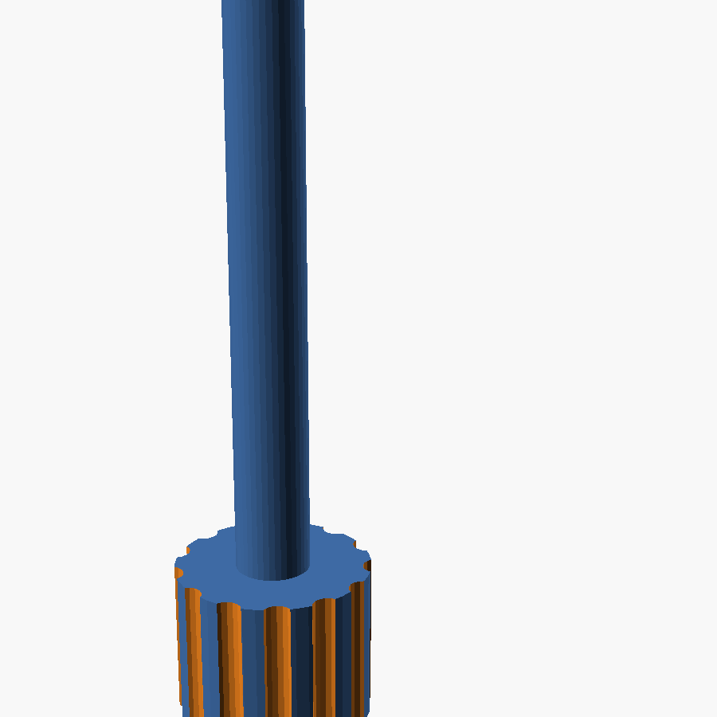

# Nut tool

A printed rod for setting nuts into nut traps you can only reach from one
side. Push a nut onto the tapered tip, slide it up the trap until it seats,
and hold it there while you start the screw from the other side. Once the
screw has caught a couple of threads, pull the tool out and finish. The
trap's hex keeps the nut from turning.

- **The shaft** is round, a little under the nut's width across flats, so
  it slides up a hex trap. Its end is the shoulder that pushes the nut.
- **The tip** is tapered, so the nut's bore grips it. The nylon insert of a
  locknut holds especially well. It is pointed, to find the hole.
- **The handle** is fluted.

All in one self-contained OpenSCAD file, `nut_tool.scad`, with no libraries
needed.

## Settings

- **`nut_size`**: #4-40, #6-32, #8-32, #10-24, #10-32, 1/4-20, M3, M4, M5 or
  M6, or `custom` with `custom_across_flats` and `custom_tip_d`.
- **`shaft_len`**: the depth of your trap, from the face you push from to
  the nut's seat, less the nut's thickness. The default, 58.7 mm, is the
  VSM Base's hinge nut traps.
- **`shaft_d`**, **`tip_d`**: 0 takes them from the nut size; set them to
  fit a particular trap or nut. If the tip is too tight or too loose in
  your nuts, adjust `tip_d` by 0.1 mm at a time.
- **`tip_len`**, **`tip_taper`**, **`handle_d`**, **`handle_len`**, and
  **`count`**, to print several side by side.

Print standing on the handle, without supports.

Spun off from the [VSM Base](../../README.md), whose main model also makes
this tool, sized to its hinge nut traps, as part `hinge_nut_tool`.

Designed by Robert Drzyzgula; the OpenSCAD code was written by Claude
(Anthropic) at his direction. MIT license; see the [LICENSE](../../LICENSE)
in the main project.
