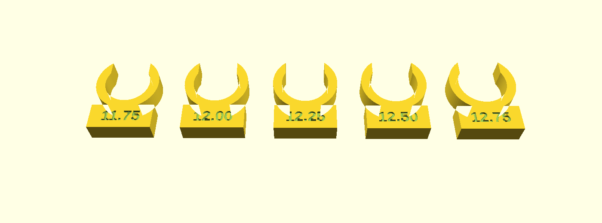

# Shaft fit collars

A set of snap-on test collars for finding the bore a printed part needs on
a shaft: a clamp ring, a collar, a hub or a pulley. Old machine shafts are
often turned down in places and needn't be any standard size, and calipers
can be hard to get onto them. Even when you know the size, printed holes
come out a little different from the drawing. The collars answer the
question that matters: what bore, as *your* printer makes it, fits this
shaft.

Each collar is a C-shaped clip with a flared mouth, so it pushes onto the
shaft from the side, without taking anything apart. Its bore is engraved
on a tab. Push each one on where the part will sit:

- **too small:** it won't seat, or goes on only with force and sits proud;
- **too large:** it turns or slides freely;
- **right:** it snaps on and turns with light drag.

Then narrow the search with a new set centered on the best fit and a
smaller step: 0.25 mm, then 0.1, then 0.05 if you need it. Each set is a
small, quick print. For a part clamped by screws across a split, the right
bore is the one that locates snugly and still turns under light force; the
clamp does the holding.

**Print the final part in the same filament and the same orientation as
the collars** (bore vertical, flat on the bed), and it will fit the same
way.

All in one self-contained OpenSCAD file, `shaft_fit_collars.scad`, with no
libraries needed.

## Settings

- **`centre`**, **`step`**, **`count`**: the middle bore, the step between
  collars and how many to print. With an odd count the center size is in
  the set.
- **`thickness`**: the collar's length along the shaft (5 mm), for short
  clear stretches.
- **`wall`**: the ring's wall (2.4 mm).
- **`mouth`**: the mouth's width as a fraction of the bore (0.86). Smaller
  snaps on more firmly; raise it if PETG clips are too stiff.
- **`lead`**, **`tab`**, **`gap`**: the mouth's lead-in, the label tab's
  size, and the spacing on the plate.

## First use

On a Kenmore 158's arm shaft (October 2026), the first set settled it in
one round: 12.5 mm spun freely, 12.0 mm went on only with force, and
12.25 mm stayed put but turned under a couple of ounces. That became the
bore of the optical encoder ring in `hardware/encoder/`.

Spun off from the [VSM Base](../../README.md). Robert Drzyzgula proposed
the collars and tested them; the design and the OpenSCAD code were written
by Claude (Anthropic) at his direction. MIT license; see the
[LICENSE](../../LICENSE) in the main project.
